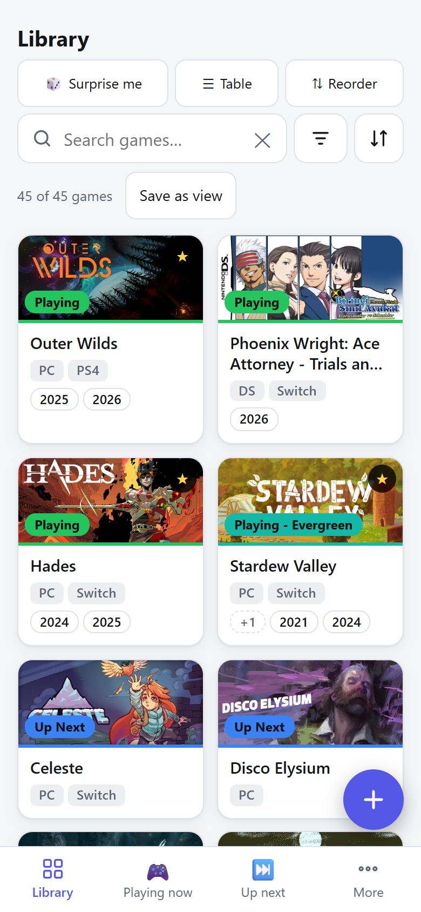
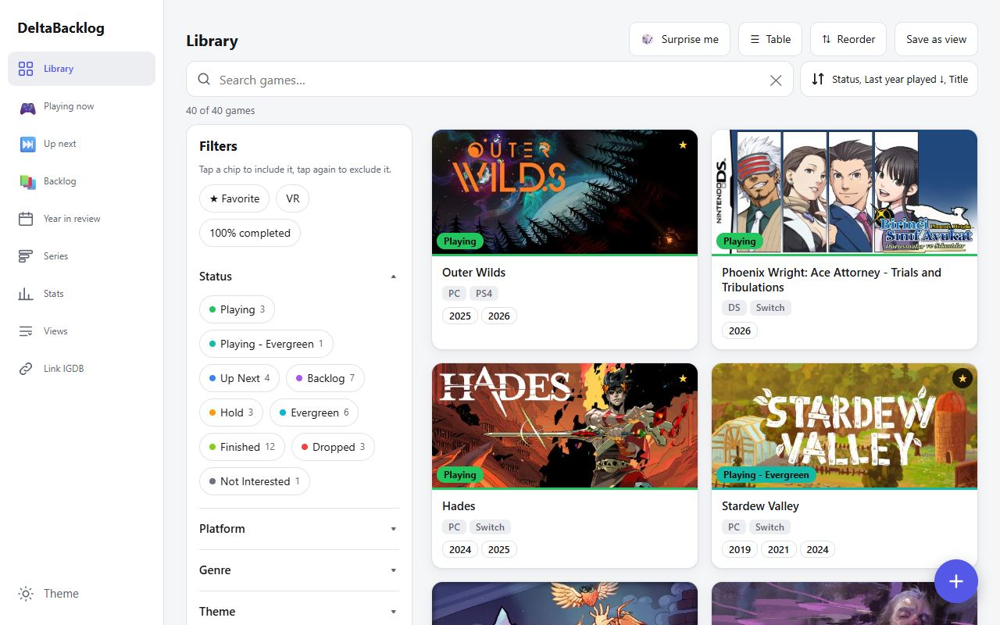
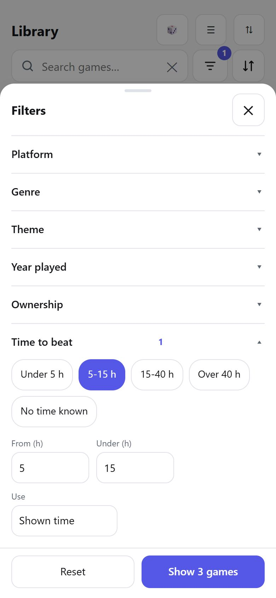
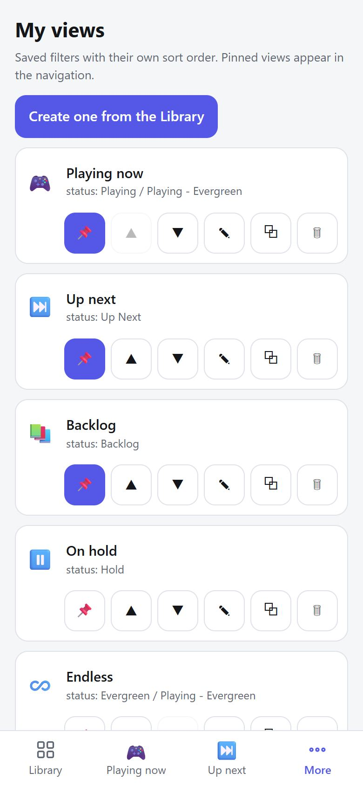
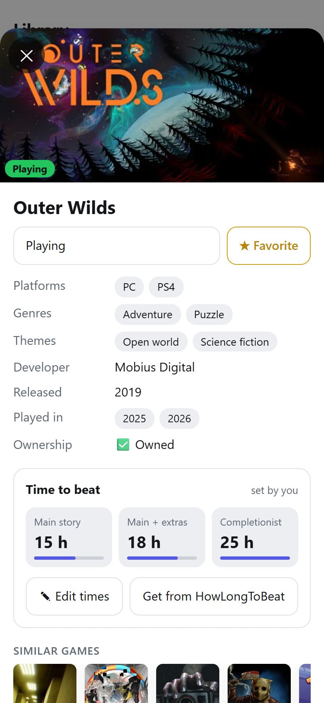
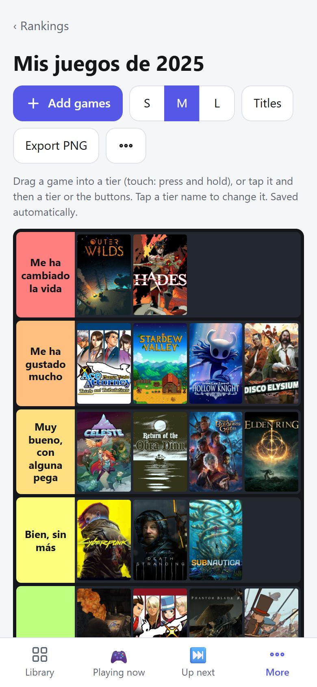

# DeltaBacklog

[](https://github.com/Deinigu/DeltaBacklog/actions/workflows/ci.yml)
[](LICENSE)

> **Personal project, shared as-is.** Not accepting pull requests or feature requests. Fork it freely ([MIT](LICENSE)). No support, no guarantees: see [How this was built](#how-this-was-built) and [Support](#support).

**A self-hosted videogame backlog tracker: one small binary, one SQLite file, no cloud, no login.** Browse and filter every game you own, keep lists like *Playing now* and *Up next*, remember which years you played what, and add new games with their cover and details filled in for you. Built for the phone first, just as comfortable on a PC, and light enough for a Raspberry Pi 3B+.

<p align="center">
  
  &nbsp;
  
</p>

<p align="center"><sub>Demo library of well-known games. Cover art from IGDB and SteamGridDB, &copy; its respective owners, shown for illustration.</sub></p>

## Features

**Find things**
- Instant search that ignores accents; filter chips combine *any* or *all* values and can *exclude* too (RPG **and** Indie, **not** Finished). The whole library is filtered in the browser, so it never waits.
- **Saved views**: any filter, sort and layout as a named view (*Playing now*, *Backlog*, *Indie RPGs to try*), pinned to the bottom bar.
- Multi-level sorting, grouping by status, platform, series, genre, year or ownership, and a spreadsheet-style **table** with inline editing and CSV export.

**Track what you play**
- **Years played** on every card, plus 🧒 childhood and ♾️ always; starting or finishing a game records the year for you.
- Your own **queue order** (drag to rank), ownership badges (🏴‍☠️ 🆓 🤝), platforms, VR, favorites and notes.
- **Series progress**, a **year in review**, TierMaker-style **rankings** (your own tiers and labels, big posters, export as a picture), and **stats** (backlog by platform, finished per year, how long games have waited).
- **Surprise me** picks a random game from what you are looking at, with filters, and never repeats.
- **Screenshots** per game: upload from your phone or computer, view full screen, caption, reorder, download the original. Originals are kept untouched, with a small thumbnail for the grid; they can live on an external drive and are backed up nightly.

**Add games quickly (optional lookups)**
- Type a title and genres, themes, developer, series, release year and a cover come from [IGDB](https://www.igdb.com/) and [SteamGridDB](https://www.steamgriddb.com/). Needs free API keys; everything else works without them.
- `deltabacklog sync-igdb` links an existing library to IGDB; uncertain matches wait in a review screen.
- `deltabacklog fetch-posters` makes the portrait posters of the rankings for the whole library in one go (they are otherwise made in the background when a game joins a ranking).

**Yours to keep**
- Covers are stored next to the database, so the app keeps working when those websites do not.
- Nightly backups on the Raspberry Pi, plus a `backup` command for anywhere else.
- A PWA: add it to your home screen (needs HTTPS or `localhost`).

<p align="center">
  
  
  
  
</p>

> **Status:** used daily by its author, but young. Prefer a [release](https://github.com/Deinigu/DeltaBacklog/releases) over `main`, and keep backups (see [Backup and restore](#backup-and-restore)). See the [changelog](CHANGELOG.md).

## Quick start

You need nothing but the binary. Pick one:

**Download a release** (Linux amd64 / arm64 / armv7, Windows, macOS): get the archive for your system from the [releases page](https://github.com/Deinigu/DeltaBacklog/releases), unpack it and run it.

```sh
./deltabacklog                      # http://localhost:8081, data in ./data
```

**Run from source** (Go 1.27+, no CGO, no frontend build step):

```sh
git clone https://github.com/Deinigu/DeltaBacklog.git
cd DeltaBacklog
go run ./cmd/deltabacklog           # http://localhost:8081, data in ./data
```

**Build a binary**:

```sh
go build -o deltabacklog ./cmd/deltabacklog
# for a Raspberry Pi 3B+ / Zero 2 (32-bit):  GOOS=linux GOARCH=arm GOARM=7 go build -o deltabacklog ./cmd/deltabacklog
```

The app starts with an empty library: use the **+** button to add games. The web files are compiled into the binary, so restart the server after changing anything in `web/static`.

> **Do not put it on the open internet.** There is no login by design. Keep it on your home network, or put a reverse proxy with authentication in front. See [SECURITY.md](SECURITY.md).

## Raspberry Pi install

DeltaBacklog is built and tested for a Raspberry Pi 3B+ (armv7, about 15 MB of memory in use). The deploy script cross-compiles on your PC, uploads over `ssh` and installs a systemd service that starts at boot, a nightly backup timer and the friendly address `http://deltabacklog.local`.

```sh
# on your PC, in the cloned repo, with Go installed and passwordless ssh + sudo on the Pi (Raspberry Pi OS / Debian)
cp .env.example .env                                     # optional: add your IGDB / SteamGridDB keys
DEPLOY_HOST=pi@raspberrypi.local bash deploy/deploy.sh --env .env
```

Run it again to update: data and settings are kept, and the database is backed up before a new version starts. To start from an existing library, add `--seed <dir>` (a folder with `app.db` and `covers/`). Open `http://deltabacklog.local`, or `http://<pi-address>:8081` if your phone cannot resolve `.local` names (some Android versions cannot). Details, paths and caveats are in the [developer manual](docs/developer-manual.md#11-build-and-deploy).

## Configuration

Settings are environment variables. A `.env` file in the working directory is loaded too (copy [`.env.example`](.env.example)); real environment variables win over it.

| Variable | Default | What it does |
|---|---|---|
| `LISTEN_ADDR` | `:8081` | Address and port to serve on. Use `127.0.0.1:8081` to keep it on this machine only. |
| `DATA_DIR` | `./data` | Where `app.db` and the `covers/` folder live. |
| `SCREENSHOTS_DIR` | `DATA_DIR/screenshots` | Where screenshots are stored, for example a folder on an external drive. When you set it, the folder must already exist: the app never creates it, so an unmounted drive cannot silently fill the system disk (uploads say "screenshot storage not available" instead). |
| `SCREENSHOT_MAX_MB`, `SCREENSHOT_REQUEST_MAX_MB` | `25`, `200` | Largest screenshot, and largest upload request, in megabytes. |
| `SCREENSHOTS_DECODE_BUDGET_MB` | `48` | Most memory the server may use to decode one screenshot for its thumbnail; bigger pictures are stored untouched with a thumbnail made by the browser. |
| `ALLOWED_HOSTS` | empty | Extra `Host` names the app answers to, comma separated. IP addresses, `localhost`, `deltabacklog.local` and the machine hostname (and `<hostname>.local`) are always allowed; any other `Host` gets 421 (DNS-rebinding protection). Needed when you reach the app by a router, Tailscale or reverse-proxy name. |
| `IGDB_CLIENT_ID`, `IGDB_CLIENT_SECRET` | empty | A Twitch application, to look games up on IGDB (add, *Fill from IGDB*, `sync-igdb`). |
| `STEAMGRIDDB_API_KEY` | empty | Enables SteamGridDB covers. |
| `GOMEMLIMIT` | unset | Go runtime soft memory limit, for example `96MiB`. The Pi install sets it; you rarely need it elsewhere. |

### Getting the keys (free)

- **IGDB**: IGDB is owned by Twitch. Create a Twitch account with two-factor authentication, register an application at [dev.twitch.tv/console/apps](https://dev.twitch.tv/console/apps) (category *Application Integration*, redirect URL `http://localhost`), then copy the **Client ID** and generate a **Client Secret**. Details: [IGDB API docs](https://api-docs.igdb.com/#account-creation).
- **SteamGridDB**: sign in at [steamgriddb.com](https://www.steamgriddb.com/), open *Preferences → API* and copy your key.

Without keys the app still works; games are added by hand. To check keys against the real services: `set -a; . ./.env; set +a; DELTABACKLOG_LIVE=1 go test ./internal/meta -run TestLive -v`.

## Commands

```sh
deltabacklog                       # serve the app
deltabacklog backup <file>         # write a consistent copy of the database (safe while it runs; never migrates it)
deltabacklog backup-screenshots <dir>  # copy the screenshot files <dir> does not have yet (never deletes)
deltabacklog check <file>          # verify a database or backup (read-only)
deltabacklog sync-igdb [--dry-run] # link games to IGDB (needs the keys)
deltabacklog fetch-posters [--dry-run] [--limit N] # make the ranking posters for every game (IGDB / SteamGridDB keys help)
```

## Backup and restore

Everything lives in `DATA_DIR`: `app.db` (the library) and `covers/` (images, which can be downloaded again), plus `screenshots/` unless `SCREENSHOTS_DIR` puts them elsewhere. Screenshots are your own files and cannot be downloaded again: back that folder up too (`deltabacklog backup-screenshots <dir>` copies only what is missing; on the Raspberry Pi install the nightly job does it).

```sh
deltabacklog backup backup-2026-01-01.db      # a consistent copy, even while the server runs
deltabacklog check backup-2026-01-01.db       # integrity, schema version and counts
```

To restore, stop the server, copy the backup over `app.db`, delete `app.db-wal` and `app.db-shm` next to it, and start the server. On the Raspberry Pi install a backup is written every night to `/var/backups/deltabacklog/` (last 14 kept); the exact restore commands are in the [developer manual](docs/developer-manual.md#11-build-and-deploy).

## Import from NocoDB (optional)

DeltaBacklog was written to replace the author's NocoDB table, so `cmd/import` reads a CSV export of that specific table. It will only be useful if you have the same column layout (`Title`, `Platform`, `Status`, `Style`, `Genre`, `Years_played`, `Series`, `Ownership`, ...; see [`internal/importer`](internal/importer)). It is safe to repeat: finished rows are skipped and failed covers are retried.

```sh
go run ./cmd/import -csv games.csv -data ./data [-nocodb http://<nocodb-host>:8080]
```

`-nocodb` is only needed for covers that were uploaded to NocoDB rather than linked.

## FAQ

**Is there a login or multiple users?** No. It is a single-user app for a trusted network. See [SECURITY.md](SECURITY.md).

**Why no ratings?** By design: this is a backlog tracker, not a review site. Ratings and a "number in the series" were removed on purpose.

**Can I run it in Docker?** There is no official image yet, but it is a single static binary with one data folder, so a `FROM scratch` image is trivial to build yourself.

**Does it work offline?** The app and your covers are served from your own machine. Lookups need internet. The offline cache of the installed PWA needs HTTPS (browsers do not allow service workers on plain `http://` outside `localhost`).

**Where does the game data come from?** From you. IGDB and SteamGridDB are only used, with your own keys, to fill in details and covers when you add or fix a game. IGDB scores and ratings are never fetched or stored.

**Does it phone home?** No telemetry. The only outgoing requests are the optional lookups above.

## Ideas

No commitment and no schedule, just things the author may or may not get to: more IGDB data (time to beat, filling empty fields), an official container image, optional HTTPS/authentication helpers, and import from other trackers. The known gaps are listed in the [developer manual](docs/developer-manual.md#12-known-gaps).

## How this was built

DeltaBacklog was built by its owner with [Claude Code](https://claude.com/claude-code) (Anthropic) agents, as an experiment in what that workflow can produce. The process:

- **Design decisions stayed with the owner:** no ratings, LAN-only with no login, light enough for a Raspberry Pi 3B+.
- **One agent per feature.** Sonnet agents implemented each feature on its own `features/<name>` branch and pull request.
- **Read-only review.** An Opus agent reviewed each PR without editing it; the owner triaged the findings and they were fixed before merging.
- **A final review.** At the end an Opus agent reviewed the whole codebase, and its findings were triaged and fixed the same way.

For scale, as of this writing: 36 merged pull requests (a few of them Dependabot updates), 8 database migrations, 19 Go test files and 18 frontend test files. The [merged pull requests](https://github.com/Deinigu/DeltaBacklog/pulls?q=is%3Apr+is%3Amerged) are the evidence; they were not curated.

## Support

None. It is shared as-is, with no support and no SLA; use it at your own risk. It is designed for a trusted home network, has no login and no HTTPS, and must not be exposed to the internet ([SECURITY.md](SECURITY.md)). Security reports are the one inbound channel, privately (see SECURITY.md); other issues and pull requests may be closed without comment ([CONTRIBUTING.md](CONTRIBUTING.md)).

## Documentation

| | |
|---|---|
| [User manual](docs/user-manual.md) | Every screen with screenshots |
| [Developer manual](docs/developer-manual.md) | Architecture, data model, every API call, frontend modules, testing, deployment |
| [Changelog](CHANGELOG.md) | What changed in each release |
| [Security policy](SECURITY.md) | Design limits and how to report a vulnerability |
| [Contributing](CONTRIBUTING.md) | Why contributions are not accepted, and forking |

## License

[MIT](LICENSE). IGDB and SteamGridDB data and artwork belong to their owners and are used through their APIs under their terms; the repository ships no cover files. The screenshots in `docs/img` show cover art from IGDB and SteamGridDB, &copy; its respective owners, for illustration only; the app downloads covers at runtime, for your own use, into your own data folder.
