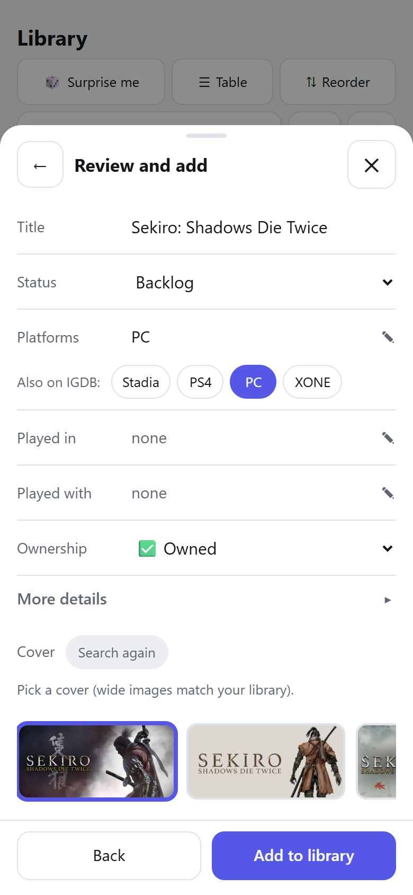
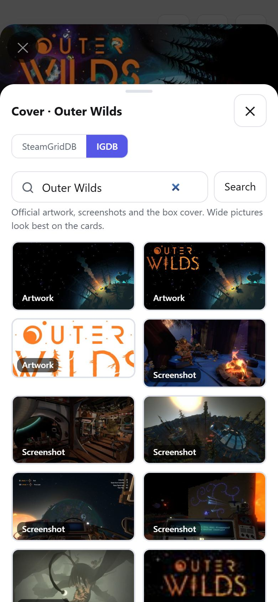

# DeltaBacklog

**Your videogame library, on your own Raspberry Pi.** Browse and filter every game you own, keep lists like *Playing now* and *Up next*, remember which years you played what, and add new games with their cover and details filled in for you. Built for the phone first; just as comfortable on a PC.

<p align="center">
  
  &nbsp;
  
</p>

One small Go program, one SQLite file, no cloud, no login. It is light enough for a **Raspberry Pi 3B+** (armv7, under 64MB of memory) and installs on your phone's home screen like an app.

## What it does

| | |
|---|---|
| **Find anything, instantly** | Search ignores accents; filter chips combine *any* or *all* values and can *exclude* too (RPG **and** Indie, **not** Finished). The whole library is filtered in the browser, so it never waits. |
| **Your own views** | Save any filter, sort and layout as a named view (*Playing now*, *Backlog*, *Indie RPGs to try*) and pin it to the bottom bar. |
| **Sort and group your way** | Any number of sort levels (status, then last year played, then title...), plus grouping by status, platform, series, genre, year or ownership. |
| **Years played at a glance** | Cards show the years you played each game, 🧒 childhood and ♾️ always, plus platform tags and ownership badges (🏴‍☠️ 🆓 🤝). Starting or finishing a game records the year for you. |
| **Rank your queue** | Drag games into your own order, with a touch-friendly handle. |
| **A real spreadsheet** | A table layout with resizable columns, inline editing of every field, Tab/Enter navigation and CSV export. |
| **Add games on the go** | Type a title: genres, themes, developer, series, release year and a cover come from IGDB and SteamGridDB, and the platform is pre-selected from the ones you play most. |
| **Edit everything** | Change any field on a phone, refill a game's details from IGDB, and swap its cover for SteamGridDB or IGDB artwork. |
| **Yours to keep** | Covers are stored on the Pi, so the app keeps working when those websites do not. |

<p align="center">
  
  
  
  
</p>

**Coming next:** Surprise me (a random pick to play), year in review and tier lists, series progress, statistics, and automatic backups with export and restore.

More in the **[user manual](docs/user-manual.md)** (with screenshots of every screen).

## Quickstart for developers

You need **Go 1.27** and **Node 20+** (Node is only for the frontend unit tests). There is no frontend build step and no CGO.

```sh
git clone https://github.com/Deinigu/DeltaBacklog.git
cd DeltaBacklog

go vet ./... && go test ./...          # backend tests
node --test web/test/*.test.mjs        # frontend logic tests

go run ./cmd/deltabacklog              # http://localhost:8081, data in ./data
```

The app starts with an empty library. Use the **+** button to add games, or import an existing one (below).

> The web files are compiled into the binary, so **restart the server after changing anything in `web/static`**. If the browser still shows the old page, reload twice.

### Optional: game lookups

Adding games with details and covers needs free API keys. Copy `.env.example` to `.env` (it is git-ignored) and fill in:

```
IGDB_CLIENT_ID=...             # a Twitch developer application
IGDB_CLIENT_SECRET=...
STEAMGRIDDB_API_KEY=...
```

Without keys everything works except the lookups: games can still be added by hand. Real environment variables win over `.env`. To check the keys against the real services: `set -a; . ./.env; set +a; DELTABACKLOG_LIVE=1 go test ./internal/meta -run TestLive -v`.

### Optional: import a NocoDB library

```sh
# 1. export the old table (here from a Raspberry Pi running NocoDB on Postgres)
ssh raspberry 'docker exec root_db psql -U postgres -d root_db -c "\copy (select id,\"Title\",\"Platform\",\"Status\",\"Style\",\"VR\",\"Genre\",\"Boxart\",\"Completed\",\"Years_played\",\"Series\",\"Notas\",\"Ownership\",\"Played_with\",\"Favorito\",nc_order from pXXXXXXXXXXXXXX.\"Games_Library\" order by id) to stdout with csv header"' > games.csv

# 2. import it (safe to repeat: finished rows are skipped, failed covers are retried)
go run ./cmd/import -csv games.csv -data ./data -nocodb http://192.168.1.50:8080
```

### Good to know

- **Port 8081 may be someone's live server.** When testing, run another instance on a spare port (`LISTEN_ADDR=127.0.0.1:18090 go run ./cmd/deltabacklog`) and address it as `127.0.0.1:<port>`.
- **Database changes are new numbered files** in `internal/db/migrations/`; never edit one that has been applied.
- **Cross-compile for the Pi:** `GOOS=linux GOARCH=arm GOARM=7 go build -o deltabacklog ./cmd/deltabacklog`.
- **Workflow:** work on a `features/<name>` branch and open a pull request into `main`; update the matching manual section when behaviour changes. See `CLAUDE.md` for the short list of rules.

### Where things are

```
cmd/deltabacklog/   the server              internal/api/    JSON API
cmd/import/         NocoDB importer          internal/db/     SQLite + migrations
web/static/         the app (vanilla JS)     internal/meta/   IGDB, SteamGridDB
web/test/           frontend unit tests      docs/            manuals and screenshots
```

The **[developer manual](docs/developer-manual.md)** covers the architecture, data model, every API call, the frontend modules and the testing approach in detail.
