# DeltaBacklog: user manual

DeltaBacklog is your videogame library on your own Raspberry Pi. You can look at your games, filter them in any way you like, keep lists such as *Playing now* and *Up next*, record the years you played each game, and add new games with their cover and details filled in for you. It is made to be used on a phone first, and it works just as well on a PC.

This manual is task by task. For how the program is built, see the [developer manual](developer-manual.md).

**Contents**
1. [Opening the app and installing it on your phone](#1-opening-the-app-and-installing-it-on-your-phone)
2. [Finding your way around](#2-finding-your-way-around)
3. [The Library: cards, search and filters](#3-the-library-cards-search-and-filters)
4. [Sorting and grouping](#4-sorting-and-grouping)
5. [Saved views](#5-saved-views)
6. [Changing a game](#6-changing-a-game)
7. [Putting games in your own order](#7-putting-games-in-your-own-order)
8. [The table (spreadsheet) layout](#8-the-table-spreadsheet-layout)
9. [Adding a game](#9-adding-a-game)
10. [Covers](#10-covers)
11. [What the little icons mean](#11-what-the-little-icons-mean)
12. [Series progress](#12-series-progress)
13. [Year in review and tier lists](#13-year-in-review-and-tier-lists)
14. [Stats](#14-stats)
15. [Surprise me: let the app choose](#15-surprise-me-let-the-app-choose)
16. [Link your games with IGDB](#16-link-your-games-with-igdb)
17. [If something looks wrong](#17-if-something-looks-wrong)
18. [Backups and what is still missing](#18-backups-and-what-is-still-missing)

---

## 1. Opening the app and installing it on your phone

Open **http://deltabacklog.local** in any browser (no port number needed). Use the same address on your phone and on your PC, as long as they are on your home network.

If that name does not open (some Android phones cannot find `.local` names), use the Raspberry Pi's number instead, for example `http://<address-of-your-pi>:8081`. Both lead to the same app.

To open it with one tap from your phone's home screen, add a shortcut:
- **Android (Chrome):** open the menu (⋮) and choose **Add to Home screen**.
- **iPhone (Safari):** tap the Share button and choose **Add to Home Screen**.

Because the Pi is reached over plain `http://`, browsers treat this as a shortcut that opens the page, not as an installed app, and the app does not keep an offline copy: it needs the Pi to be reachable.

The app follows your phone's light or dark setting. On a PC, the **Theme** button at the bottom of the left sidebar switches between them.

## 2. Finding your way around

**On a phone** the bar at the bottom has **Library**, your first two pinned views (for example *Playing now* and *Up next*) and **More**. **More** opens a list with **Series** ([section 12](#12-series-progress)), **Stats** ([14](#14-stats)), **Year in review** ([13](#13-year-in-review-and-tier-lists)) and **Views** (where you manage your views), plus **Link IGDB** ([16](#16-link-your-games-with-igdb)) while there is something to review. It is highlighted while you are on one of those pages. The round **+** button adds a game.

**On a PC** the same things are in the left sidebar, with every pinned view and every page listed directly (there is no *More*). Two keys help: press **/** to jump to the search box and **n** to add a game.

The **More** list on a phone:

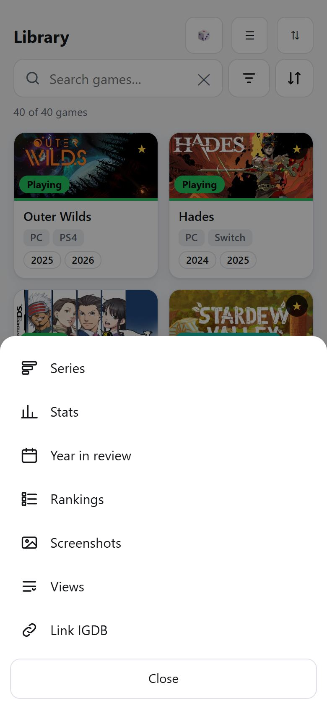

## 3. The Library: cards, search and filters

The Library shows every game as a card.

**What is on a card**
- The cover, with the game's **status** in the bottom-left corner (and a coloured line under the cover in the same colour).
- A **★** in the top-right corner for favourites.
- A small emoji in the top-left corner when the game is *not* a plain "Owned" game (for example 🏴‍☠️ or 🆓, see [section 11](#11-what-the-little-icons-mean)).
- Under the title: the **platforms** (the first two) and the **years you played it**. The newest years are shown as small pills. A dashed **+3** means three older years are not shown. 🧒 means you played it as a child and ♾️ means you have always played it. Touch or hover over the years to read them in full.

**Search.** Type in the search box. It looks in the title, series, developer and notes, and it ignores accents, so "pokemon" finds *Pokémon*.

**Filters.**

Tap the filter button (the three lines next to the search box). On a PC the filters are always shown on the left.

- **Tap a chip once to include it.** For example *Platform: PC* shows only PC games.
- **Tap it again to exclude it.** The chip turns red and is crossed out. For example *Finished* excluded hides finished games.
- **Tap a third time to clear it.**
- When you include two or more values in *Platform*, *Genre*, *Theme*, *Year played* or *Played with*, a switch **Any / All** appears. *Any* shows games that have at least one of them. *All* shows only games that have every one of them (for example games that are both *RPG* and *Indie*).
- At the top are three quick switches: **Favorite**, **VR** and **100% completed**.
- The number on each chip is how many games would match if you tapped it, taking your other filters into account. Chips that would give nothing are faded.
- The active filters appear as pills under the search box. Tap a pill's **✕** to remove it, or **Reset** to clear everything.
- The button at the bottom shows how many games match (*Show 27 games*).

The address in your browser changes with your filters, so you can bookmark a filtered list.

## 4. Sorting and grouping

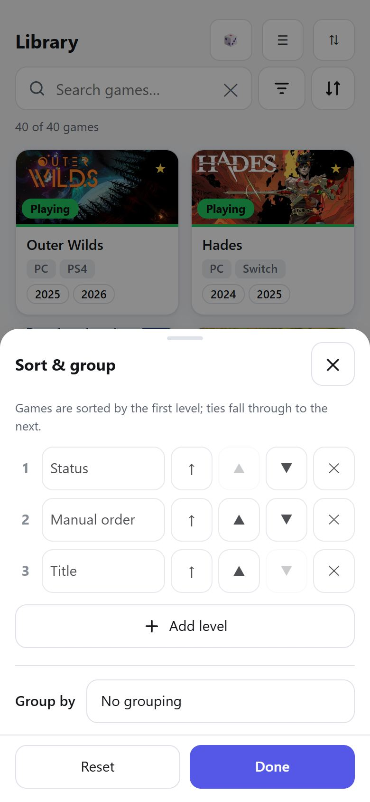

Tap the sort button (the up/down arrows at the right of the search box).

- **Sort levels.** Games are sorted by the first level. When two games tie, the next level decides, and so on. Each level has a field, an arrow for ascending or descending (↑ / ↓), buttons to move it up or down, and ✕ to remove it. **Add level** adds another one.
- **Fields you can sort by:** Title, Status, Platform, Series, Release year, Last year played, First year played, Years played (count), Date added, Date edited, Favorites first, 100% completed first, and Manual order.
- Titles sort naturally ("Fallout 2" comes before "Fallout 10"), and games that have no value for a field always go last.
- **Default order** is: Status, then your Manual order, then Title.
- **Group by** splits the list into sections: Status, Platform, Series, Genre, Year played or Ownership. A game that was played in several years appears under each year, and one with several genres under each genre.
- **Reset** returns to the default order.

## 5. Saved views

A **view** is a name for a set of filters, a sort order and a layout, so you can open it with one tap.

**Starter views.** You start with five: **Playing now**, **Up next**, **Backlog**, **On hold** and **Endless**. The first three are pinned; the bottom bar of a phone shows the first two (the sidebar shows all). They are ordinary views: change them or delete them.

**Make your own.**
1. Set up filters, sorting and (if you like) grouping or the table layout in the Library.
2. Tap **Save as view**, type a name and an emoji, and tap **Save**.
3. The view now appears in the sidebar and, if it is one of your first two pinned views, in the bottom bar of a phone. Other pinned views are reached through **More → Views**.

**Using a view.**
- Open it from the bar. If you then change its filters or sort, a **Save** button appears. Tap it to keep the changes, or **Revert** to go back to how it was saved.
- **Save as…** makes a new view from the current state without touching the old one.
- Tap the view's title to rename it.

**Manage views.** Open **Views** (**More** on a phone, or the sidebar). For each view you can open it, **📌 pin** it to the bar, move it **▲▼**, rename it **✎**, duplicate it **⧉**, or delete it **🗑**. After a delete there is an **Undo** for a few seconds.

## 6. Changing a game

Tap a card to open the game.

**Quick changes** (at the top, saved at once)
- **Status:** pick Playing, Playing - Evergreen, Up Next, Backlog, Hold, Evergreen, Finished, Dropped or Not Interested. A game that changes status goes to the end of your manual order.
- **★ Favorite** switches the favourite mark.
- **The year is added for you.** When you set a game to **Playing**, **Playing - Evergreen** or **Finished**, the current year is added to its years played (once).

**Edit** changes everything else.

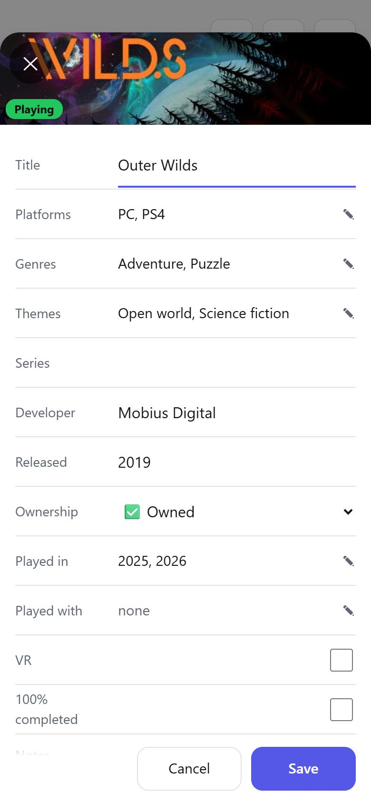

Tap **✎ Edit**. You can change the title, platforms, genres, themes, series, developer, release year, ownership, the years played, who you played with, VR, 100% completed and notes. Tap a list (like *Genres*) to open a sheet where you tick values and can type a new one. For **Played in** you can add years (4 digits, from 1970 to 2100) or the periods *Childhood* and *Always*.
- **Save** keeps your changes. **Cancel** or the ✕ asks before throwing away unsaved edits.
- **Fill from IGDB…** looks the game up on IGDB, lets you pick the right match, and copies its genres, themes, developer, series and release year into the form. Your platforms, notes and ownership are not touched. Check the form, then **Save**. The game is then linked to IGDB (shown as *Linked to IGDB*, with **Unlink** if it was the wrong match).

**Change cover** is explained in [section 10](#10-covers). **Delete game** removes the game for good, after a confirmation: its years and cover go with it and it cannot be undone.

## 7. Putting games in your own order

The *manual order* is how you rank games yourself, for example the order you plan to play your *Up next* games.

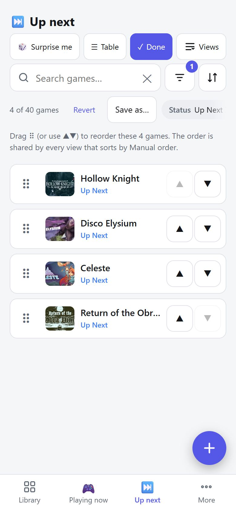

1. Open the view or the Library list you want to order (for example *Up next*).
2. Tap **⇅ Reorder** (on a phone, the icon with two arrows).
3. Drag the **⠿** handle to move a game, or use the **▲ ▼** buttons.
4. Tap **✓** (Done).

What to know:
- The order is saved as soon as you move a game.
- Only the games in the list are moved. Your other games keep their place.
- One order is shared by all views. A view shows it when it sorts by *Manual order*, which the default order does.

## 8. The table (spreadsheet) layout

Tap **☰ Table** (next to the title) to see your games as a table. Tap **▦ Cards** to go back. The layout is part of a saved view, so you can keep a table view of your backlog.

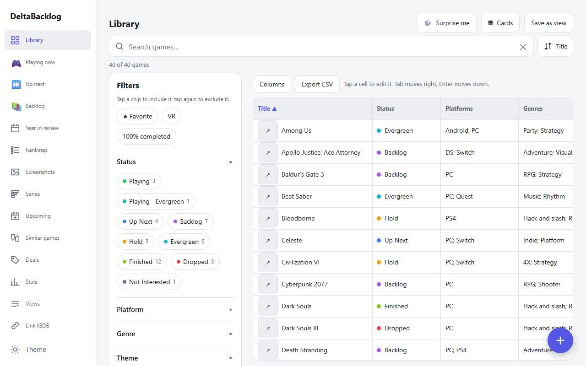

- **Sort** by tapping a column heading. Tap again to reverse it.
- **Resize** a column by dragging the edge of its heading.
- **Columns** lets you choose which columns to show (title, status, platforms, genres, themes, years played, series, developer, released, ownership, played with, favorite, VR, 100%, notes, added). **Defaults** brings the original set back. Your choices are remembered on this device.
- **Edit in place:** tap a cell and type. **Enter** saves and moves down, **Tab** saves and moves right, **Esc** cancels. Status is a drop-down, checkboxes toggle with one tap, and lists (platforms, genres, years...) open a sheet. Notes can have several lines (**Shift+Enter** for a new line).
- The ↗ button at the start of a row opens the game.
- **Export CSV** saves exactly the rows and columns you see as a file you can open in Excel or Google Sheets.
- On a phone the table scrolls sideways, with the title column kept in place.

## 9. Adding a game

Tap **+**.

1. **Type the title.** After a moment you see matching games from IGDB, with cover, year, developer and genres. A match that is already in your library has an orange **Already in your library** label.
2. **Tap the right one.**
3. **Check the form.** Genres, themes, developer, series and release year are filled in for you. You choose the **status** (Backlog by default), the **platforms** and the **ownership** (Owned by default).
   - **Platforms:** the platform you play most among the ones the game is on is selected for you (for a PC game that is PC). The other platforms IGDB lists appear as chips: tap one to add or remove it.
   - **Cover:** a row of pictures from SteamGridDB appears. The first is chosen. Tap another one, or **No cover**. **Search again** looks again with the title you typed.
4. **Add to library.** The game is added at the end of your manual order and opens so you can adjust it.

If the game is not found, tap **Add "..." without a lookup** to type everything in yourself. The lookups need keys that are set up once on the Pi (see the [developer manual](developer-manual.md#3-running-it)). Without them you can still add games by hand.

## 10. Covers

Open a game and tap **Change cover**.

- Two tabs: **SteamGridDB** (community covers; wide pictures match your library) and **IGDB** (official artwork, screenshots and the box cover, each labelled). The tab you used last is remembered.
- The search box starts with the game's title. Type another title and tap **Search** when the automatic match is the wrong game.
- Tap a picture to use it. It is saved on your Raspberry Pi, so the app does not depend on those websites afterwards.
- Cards show the cover as a wide picture, so wide images look best.

## 11. What the little icons mean

**Ownership** (filters, the table, the game's details and a badge on cards):

| Icon | Meaning |
|---|---|
| ✅ | Owned (shown on cards only for the other kinds, to keep them calm) |
| 🏴‍☠️ | Pirated |
| 🆓 | Free to play |
| 👨‍👩‍👧 | Family share |
| 🤝 | Borrowed |
| 🚫 | Nope |
| 🏷️ | Any other value you add yourself |

**Years played on a card:** 🧒 childhood · ♾️ always played · a dashed **+N** older years not shown.

## 12. Series progress

Open **Series** in the navigation (**More** on a phone) to see how far you are through every series. Each series is a card with its name, a progress bar and a line such as *3 finished · 4 played · 5 games · 1 left to play*. Tap a card to open the list of its games, and tap a game to open its details.

- **Finished** means the game's status is **Finished**.
- **Played** means you have started it: it is Finished, or its status is Playing, Playing - Evergreen, Evergreen, Hold or Dropped, or it has any year (or Childhood / Always) in *Played in*. Finished games count as played too.
- **Left to play** means a game you have not played yet (for example Backlog or Up Next). Games marked **Not Interested** are not counted as left to play, but they still count in the total.
- The bar is green for finished games, in the accent colour for games played but not finished, and grey for the rest.
- **Games left to play** (the button at the top) hides series where nothing is left.
- Games are listed by **release year** (games without a year come last), then by title. There is no "number in the series": the release year puts a game in its place. Games imported from another tool usually have no year yet: open a game, tap **✎ Edit** and **Fill from IGDB…**, and the year is set. The page tells you how many games still have no year.
- A game's details show where it falls, for example **3 of 5 in Ace Attorney**, only when every game of that series has a release year (otherwise they show *Ace Attorney (5 games)*, because the order would be a guess). It appears only for series with at least two games. A series is every game with the same series name; capital letters do not matter.

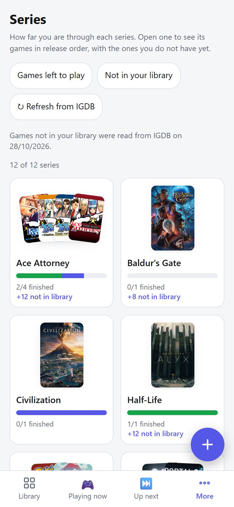

## 13. Year in review and tier lists

**Year in review** (under **More** on a phone) opens the latest year you played something. A game belongs to a year when that year is in its *Years played* (moving a game to Playing or Finished adds the current year by itself). Childhood and "always played" do not count as a year.

- **The page.** The big **‹** and **›** buttons go to the previous and next year (one calendar year at a time, so a year with no games is reachable too; it says nothing was recorded). The strip under the title jumps to any year, with the number of games.
- **Counts.** Games are grouped by their *current* status: **Finished**, **Dropped**, **Still playing** (Playing and Playing - Evergreen) and **Played** (everything else, for example Evergreen or Backlog). Next to them are the platforms and genres you played that year. Tap any game to open its details.
- **Tier list.** Every game of that year starts in *Not ranked*. Put it in a tier **S, A, B, C, D or F**: on a PC drag it with the mouse; on a phone **press and hold** until it lifts, then drag (near the top or bottom edge the page scrolls by itself). The easiest way on a phone: **tap a game** and choose the tier from the list that opens (**Not ranked** takes it out again). Dropping between games sets their order inside the tier. Every change is saved automatically, and each year has its own list.
- **Export PNG** saves the tier list as a picture to share.

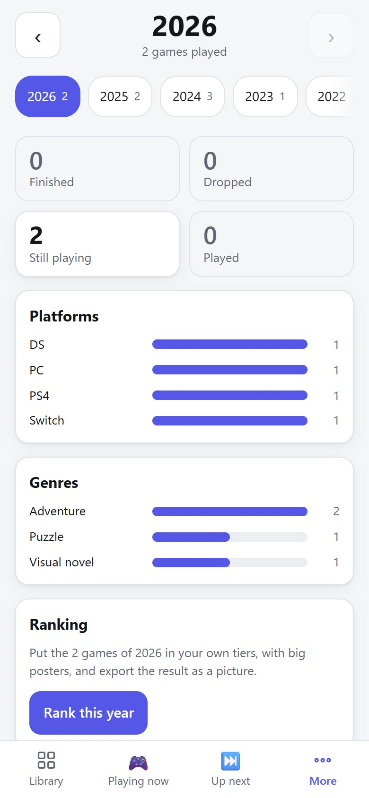

If you remove a year from a game, the game leaves that year's tier list (and comes back to its tier if you add the year again).

## 14. Stats

Open **Stats** in the navigation (**More** on a phone). Everything is worked out from the games you already have; nothing is stored.

- **Backlog**: how many games are on the backlog or up next, and how many per platform (a game on two platforms counts for both).
- **Finished per year**: a bar chart of games with the status Finished, counted in the last year you played them. Finished games you played in *Childhood* or *Always* (no calendar year) and finished games with nothing recorded are mentioned separately under the chart, not drawn.
- **Time waiting**: for Backlog, Up Next and Hold, the typical and longest time since a game was last changed, and the five games that have waited longest (tap one to find it in the Library). This is a rough guide: any edit resets the clock. Games you have not touched since the import are left out (the card says how many), and until the rest were changed over at least a week it tells you there is nothing to compare yet.
- **Most played genres**: genres of the games you have played (a year or period recorded, or a status such as Playing, Finished or Dropped).
- **Finished or dropped**: the share of games you finished against dropped.

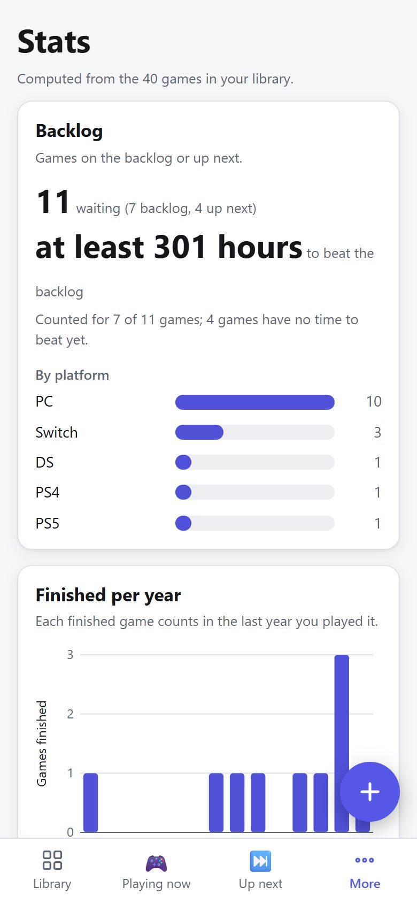

The charts have text labels and work in light and dark. Screen readers get the numbers as a table.

## 15. Surprise me: let the app choose

Can't decide what to play? Tap **🎲 Surprise me** at the top of the Library or of any saved view (on a phone it is the dice icon, from 600px wide it also has its name). On a phone, **Save** and **Save as…** sit in the row under the search box (next to **Revert**), so the top row and the view name stay as they are.

**What it picks from.** The games that Library or view is showing right now, including your search and filters. With no filters at all it picks from your **Up next** games, or from **Backlog** if Up next is empty. Games that are Finished, Dropped, Not Interested or Evergreen are never offered, unless you filtered to that status on purpose.

**Your mood (optional).** A sheet opens first. Tap any of these to narrow the pick; the number on each chip is how many games would be left:
- **Platform** and **Genre**: tap one or more (a game needs to match any of the ones you tap in that row).
- **VR only**.
- **Not played recently**: games you never played, or whose last year played is two or more years ago. A game you play "always" never counts.

If nothing fits, **Pick one** is greyed out and says so; remove a choice. Then tap **Pick one**.

**The result.** You see the cover, the title, platforms, genres and the years you played it, and three buttons:
- **▶ Play it** sets the game to *Playing* (the app records the current year for you) and closes the sheet. An Evergreen game becomes *Playing - Evergreen* instead, and a game you are already playing is left as it is (the button then reads *Already playing*).
- **Another one** shows a different game. It never shows the same game twice until you have seen them all; then it tells you and offers **Start over**.
- **Skip** is like *Another one*, and also leaves that game out for the rest of your browser session (until you close the tab). If you skip everything, **Forget my skips** brings back the skipped games that fit this pick (skips from other views stay skipped).

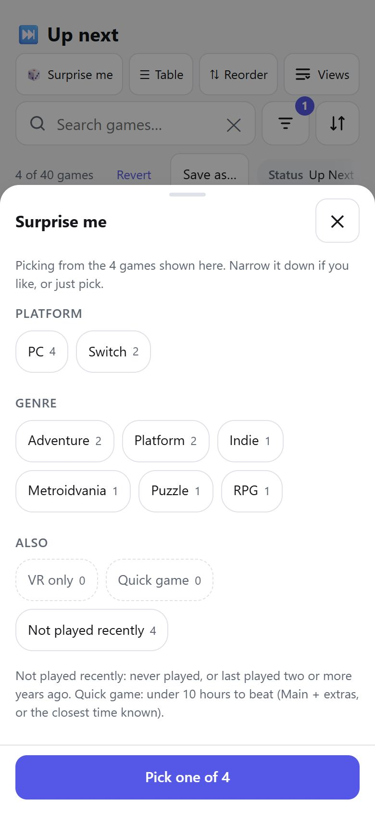

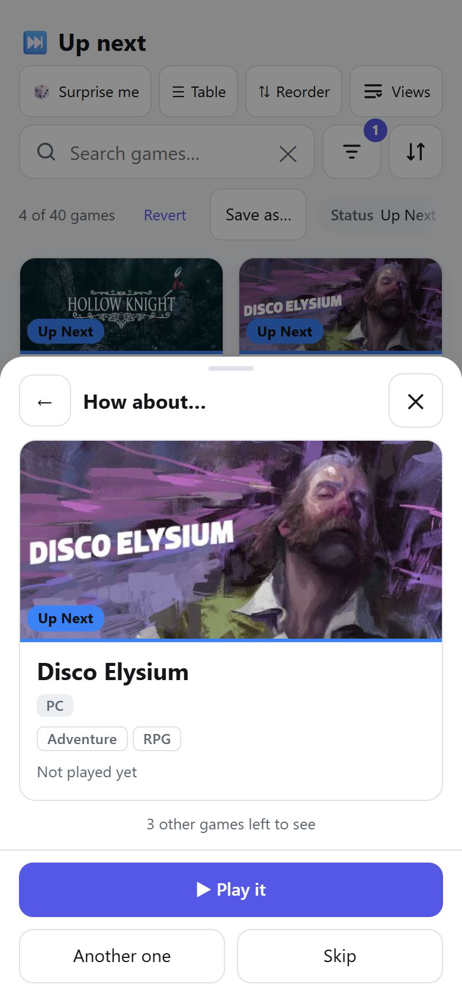

The **←** button goes back to the mood, and **✕** (or Escape) closes the sheet without changing anything.

## 16. Link your games with IGDB

Games imported from your old table are not yet connected to their page on IGDB, the game database the app uses for covers and details. A one-off command on the Pi, `deltabacklog sync-igdb`, connects them (the steps are in the [developer manual](developer-manual.md#8-external-services); `--dry-run` shows what it would do without changing anything). Restart the app afterwards so it shows the new links. It is safe: it first saves a copy of your library, and it only sets the link. It never changes anything you typed, and the app does not show IGDB's scores.

Most games are linked automatically. The ones the app is not sure about wait for you in **Link IGDB** (an entry in the navigation that only appears while there is something to review).

For each game you see its title, year and platforms, and IGDB's best guesses with the platforms IGDB lists for each (handy when two games share a name) and a percentage that says how closely the title matches. A low percentage means the app found no close match and shows IGDB's top results anyway, in case one is right. **IGDB ↗** opens that game's page on igdb.com:
- Tap **Link** next to the right guess.
- **Search IGDB…** lets you look for it yourself; tap the right result.
- **Not on IGDB** if the game is not there at all (a fan game, a regional title). The app will not ask again.
- **Skip** leaves it for later; it comes back the next time you open the screen, or with **Review them again**.

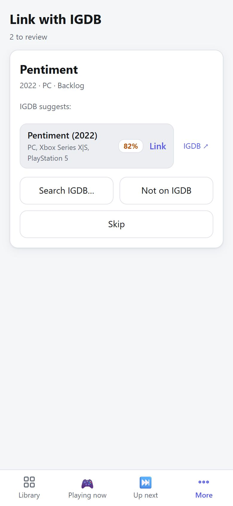

If IGDB's game is already linked to another game in your library you are told which one, and nothing changes. A game that already has a link (for example linked on another device) is never re-linked from this screen.

## 17. If something looks wrong

- **The page looks old after an update.** Reload it twice (on a PC: Ctrl+Shift+R). If it still looks old, clear the site's data in your browser settings once.
- **"Lookups are not set up".** The IGDB or SteamGridDB key is missing on the Pi. Games can still be added by hand.
- **A cover is missing.** Open the game, tap **Change cover** and pick one. Adding a game never fails because of a cover: if the picture could not be downloaded you are told, and the game is added anyway.
- **A change did not save.** You see a message at the bottom. The game goes back to how it was, so try again.
- **I added the same game twice.** The add form warns you when a game with the same title or IGDB link is already there. Open the extra copy and use **Delete game**.

## 18. Backups and what is still missing

**Backups happen by themselves.** Every night at 03:30 the Raspberry Pi saves a copy of your library and keeps the last 14 days. Restoring one is described in the [developer manual](developer-manual.md#11-build-and-deploy).

**Not built yet:** a full export of everything (the **Export CSV** button of the table, [section 8](#8-the-table-spreadsheet-layout), already saves the games you see).
