# DeltaBacklog: user manual

DeltaBacklog is your videogame library on your own Raspberry Pi. You can look at your games, filter them in any way you like, keep lists such as *Playing now* and *Up next*, record the years you played each game, and add new games with their cover and details filled in for you. Around the library sit pages that help you decide what to play next and what to buy: series progress, upcoming releases, similar games and deals. It is made to be used on a phone first, and it works just as well on a PC.

This manual is task by task. For how the program is built, see the [developer manual](developer-manual.md).

**Contents**

*Getting started*
1. [Opening the app and installing it on your phone](#1-opening-the-app-and-installing-it-on-your-phone)
2. [Finding your way around](#2-finding-your-way-around)
3. [Setting up keys](#3-setting-up-keys)

*Your library*

4. [The Library: cards, search and filters](#4-the-library-cards-search-and-filters)
5. [Sorting and grouping](#5-sorting-and-grouping)
6. [Saved views](#6-saved-views)
7. [Changing a game](#7-changing-a-game)
8. [Putting games in your own order](#8-putting-games-in-your-own-order)
9. [The table (spreadsheet) layout](#9-the-table-spreadsheet-layout)
10. [Surprise me: let the app choose](#10-surprise-me-let-the-app-choose)
11. [Adding a game](#11-adding-a-game)
12. [Covers and posters](#12-covers-and-posters)
13. [What the little icons mean](#13-what-the-little-icons-mean)

*The pages in the More list* (in the order a phone shows them)

14. [Series](#14-series)
15. [Upcoming releases](#15-upcoming-releases)
16. [Similar games](#16-similar-games)
17. [Deals](#17-deals)
18. [Stats](#18-stats)
19. [Year in review](#19-year-in-review)
20. [Rankings](#20-rankings)
21. [Screenshots](#21-screenshots)
    (**Views** is described in [section 6](#6-saved-views); **Hidden** in [section 17](#the-hidden-page); **Needs attention** and **Link IGDB** in [section 22](#22-link-your-games-with-igdb).)
22. [Link your games with IGDB, and Needs attention](#22-link-your-games-with-igdb)

*Good to know*

23. [Refresh buttons](#23-refresh-buttons)
24. [If something looks wrong](#24-if-something-looks-wrong)
25. [Backups and what is still missing](#25-backups-and-what-is-still-missing)

---

## 1. Opening the app and installing it on your phone

Open **http://deltabacklog.local** in any browser (no port number needed). Use the same address on your phone and on your PC, as long as they are on your home network.

If that name does not open (some Android phones cannot find `.local` names), use the Raspberry Pi's number instead, for example `http://<address-of-your-pi>:8081`. Both lead to the same app.

The app can also sit under a sub-path of another address, when a reverse proxy on the Pi publishes it there (for example **http://\<pi-name\>.local/backlog/**, with the slash at the end). Everything works the same; the proxy's name must be in `ALLOWED_HOSTS` (see "unknown host" in [section 24](#24-if-something-looks-wrong)).

To open it with one tap from your phone's home screen, add a shortcut:
- **Android (Chrome):** open the menu (⋮) and choose **Add to Home screen**.
- **iPhone (Safari):** tap the Share button and choose **Add to Home Screen**.

Because the Pi is reached over plain `http://`, browsers treat this as a shortcut that opens the page, not as an installed app, and the app does not keep an offline copy: it needs the Pi to be reachable.

The app follows your phone's light or dark setting. On a PC, the **Theme** button at the bottom of the left sidebar switches between them.

## 2. Finding your way around

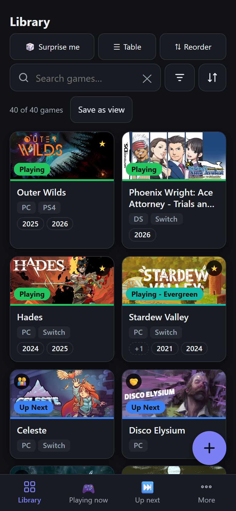

**On a phone** the bar at the bottom has **Library**, your first two pinned views (for example *Playing now* and *Up next*) and **More**. **More** opens a list of pages, in this order:

| Page | What it is for | Section |
|---|---|---|
| **Series** | how far you are through every series | [14](#14-series) |
| **Upcoming** | new games of your series that are not out yet | [15](#15-upcoming-releases) |
| **Similar games** | games you might like, from the ones you finished | [16](#16-similar-games) |
| **Deals** | what the games you don't own and haven't played yet cost right now | [17](#17-deals) |
| **Stats** | numbers about your library | [18](#18-stats) |
| **Year in review** | what you played in a year | [19](#19-year-in-review) |
| **Rankings** | tier lists of your games | [20](#20-rankings) |
| **Screenshots** | every picture of every game | [21](#21-screenshots) |
| **Views** | manage your saved views | [6](#6-saved-views) |
| **Hidden** | everything you hid, with Show again | [17](#the-hidden-page) |
| **Needs attention** | games that need a fix: no link, cover, poster, time or platform... | [22](#needs-attention) |
| **Link IGDB** | only while there is something to review | [22](#22-link-your-games-with-igdb) |

**More** is highlighted while you are on one of those pages. The round **+** button adds a game; it is shown on the Library, your saved views and shelves (Playing now, Up next), not on the other pages (the **n** key adds a game from anywhere).

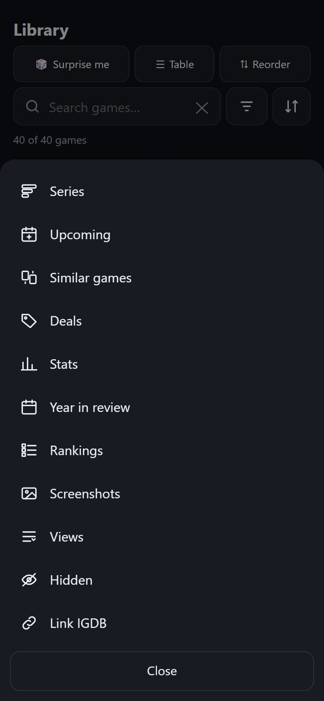

**On a PC** the same pages are in the left sidebar, with every pinned view and every page listed directly (there is no *More*). The sidebar groups the pages a little differently: Year in review, Rankings, Screenshots, then Series, Upcoming, Similar games, Deals, Stats, Views, Hidden and Needs attention, with Link IGDB at the end while there is something to review. Two keys help: press **/** to jump to the search box and **n** to add a game.

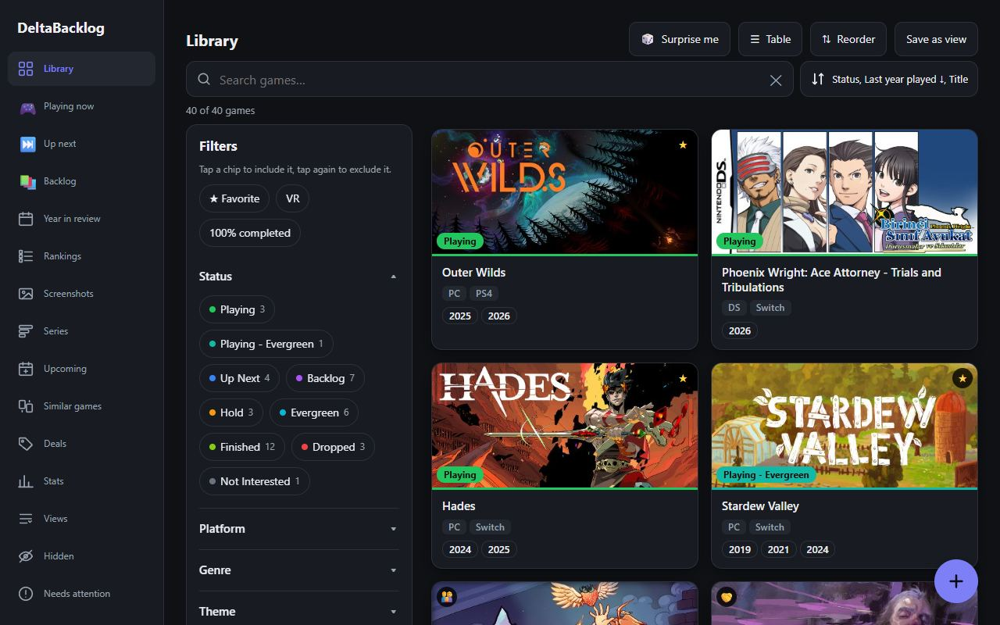

## 3. Setting up keys

The app works without any key: you can add games by hand, filter, sort, rank and keep screenshots. Keys switch on the pages and lookups that talk to other websites. They are set once, by whoever installs the app, in the settings file of the app: `.env` when you run it on a PC, `/etc/deltabacklog.env` on the Raspberry Pi (`deploy.sh --env .env` copies the keys there for you). After changing the file, restart the app (`sudo systemctl restart deltabacklog` on the Pi). The keys are never shown in the app and never leave the server.

| What it switches on | Settings | Where to get it (free) |
|---|---|---|
| **IGDB**: looking games up when you add one, **Fill from IGDB**, Link IGDB, time to beat, game modes, store buttons, Series' games you do not have, Upcoming dates, Similar games | `IGDB_CLIENT_ID`, `IGDB_CLIENT_SECRET` | IGDB belongs to Twitch. Create a Twitch account with two-factor authentication, register an application at [dev.twitch.tv/console/apps](https://dev.twitch.tv/console/apps) (category *Application Integration*, redirect URL `http://localhost`), then copy the **Client ID** and generate a **Client Secret**. |
| **SteamGridDB**: more covers and portrait posters | `STEAMGRIDDB_API_KEY` | Sign in at [steamgriddb.com](https://www.steamgriddb.com/), open *Preferences → API* and copy the key. |
| **IsThereAnyDeal**: the Deals page | `ITAD_API_KEY` | Create an app at [isthereanydeal.com/apps](https://isthereanydeal.com/apps/) and copy its API key. |
| **Steam wishlist**: the Wishlist section of Deals (optional) | `STEAM_ID` | Your 17-digit SteamID64, the long number of your account. In Steam, click your name at the top right, choose *Account details* and copy the number under your account name (*Steam ID*), or look your profile up on [steamid.io](https://steamid.io). No Steam key is needed, but your wishlist must be public: in Steam open *your name → View my profile → Edit Profile → Privacy Settings* and set **Game details** to **Public** (more in [section 17](#17-deals)). |
| **Telegram**: price alerts on your phone (optional) | `TELEGRAM_BOT_TOKEN`, `TELEGRAM_CHAT_ID` | Talk to [@BotFather](https://t.me/BotFather) on Telegram to make a bot and copy its token (it looks like `123456789:ABC…`), then send your bot any message and open `https://api.telegram.org/bot<your token>/getUpdates` in a browser: the number after `"chat":{"id":` is your chat id (`-100…` for a group; a channel can use `@channelname`). Do not share that address, it contains your token. Once both are set, the **i** panel of **Deals** shows **Send test message** ([section 17](#17-deals)). If you already run a bot for another service (for example the Raspberry Dashboard), you can reuse its token and chat id. |

A page whose key is missing says *not set up* and its refresh button is off; nothing else is affected. The sections below that need a key say so in their first line. The IGDB step of linking games you already have is explained in [section 22](#22-link-your-games-with-igdb).

## 4. The Library: cards, search and filters

The Library shows every game as a card.

**What is on a card**
- The cover, with the game's **status** in the bottom-left corner (and a coloured line under the cover in the same colour).
- A **★** in the top-right corner for favourites.
- A small emoji in the top-left corner when the game is *not* a plain "Owned" game (for example 🏴‍☠️ or 🆓, see [section 13](#13-what-the-little-icons-mean)).
- Under the title: the **platforms** (the first two) and the **years you played it**. The newest years are shown as small pills. A dashed **+3** means three older years are not shown. 🧒 means you played it as a child and ♾️ means you have always played it. Touch or hover over the years to read them in full.

**Search.** Type in the search box. It looks in the title, series, developer and notes, and it ignores accents, so "pokemon" finds *Pokémon*.

**Filters.**

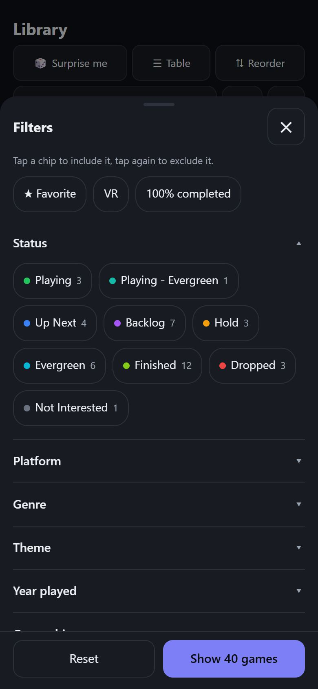

Tap the filter button (the three lines next to the search box). On a PC the filters are always shown on the left.

- **Tap a chip once to include it.** For example *Platform: PC* shows only PC games.
- **Tap it again to exclude it.** The chip turns red and is crossed out. For example *Finished* excluded hides finished games.
- **Tap a third time to clear it.**
- When you include two or more values in *Platform*, *Genre*, *Theme*, *Game mode*, *Perspective*, *Year played* or *Played with*, a switch **Any / All** appears. *Any* shows games that have at least one of them. *All* shows only games that have every one of them (for example games that are both *RPG* and *Indie*).
- At the top are quick switches: **Favorite**, **VR** and **100% completed**.
- **Time to beat** (once some game has a time) filters by how long a game takes. Tap a quick range (**Under 5 h**, **5-15 h**, **15-40 h**, **Over 40 h**) or type your own in **From** and **Under** (hours: `7.5`, or `45m`; a game passes when it is from the first number up to, but not including, the second). **No time known** works like the other chips: tap once to see only games without a time, again to hide them, a third time to clear it. Next to the range, **Use** picks which time counts: the one shown in the details (the default), **Main story**, **Main + extras** or **Completionist**.
- **Game mode** (single player, co-op, multiplayer...) and **Perspective** (first person, third person, isometric...) come from IGDB and appear in the filters as soon as some game has them.
- The number on each chip is how many games would match if you tapped it, taking your other filters into account. Chips that would give nothing are faded.
- The active filters appear as pills under the search box. Tap a pill's **✕** to remove it, or **Reset** to clear everything.
- The button at the bottom shows how many games match (*Show 27 games*).

The address in your browser changes with your filters, so you can bookmark a filtered list.

## 5. Sorting and grouping

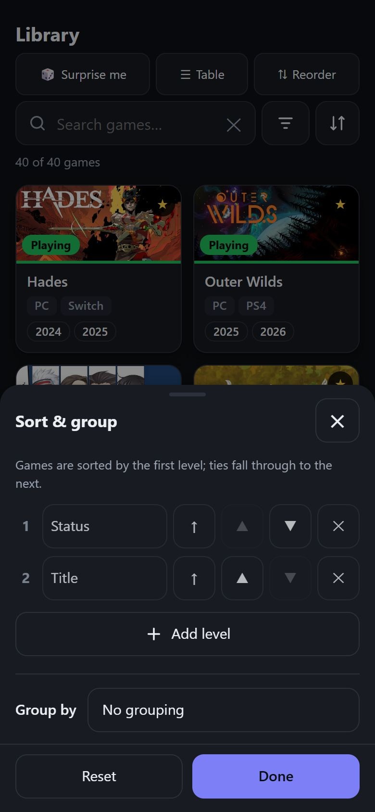

Tap the sort button (the up/down arrows at the right of the search box).

- **Sort levels.** Games are sorted by the first level. When two games tie, the next level decides, and so on. Each level has a field, an arrow for ascending or descending (↑ / ↓), buttons to move it up or down, and ✕ to remove it. **Add level** adds another one.
- **Fields you can sort by:** Title, Status, Platform, Series, Release year, Last year played, First year played, Years played (count), Time to beat (shortest first; games without a time last), Date added, Date edited, Favorites first, 100% completed first, and Manual order.
- Titles sort naturally ("Fallout 2" comes before "Fallout 10"), and games that have no value for a field always go last.
- **Default order** is: Status, then Title. It does not use your Manual order: to see your own ranking, add **Manual order** as a sort level (the starter *Up next* and *Playing now* views already do).
- **Group by** splits the list into sections: Status, Platform, Series, Genre, Year played or Ownership. A game that was played in several years appears under each year, and one with several genres under each genre.
- **Reset** returns to the default order.

## 6. Saved views

A **view** is a name for a set of filters, a sort order and a layout, so you can open it with one tap.

**Starter views.** You start with five: **Playing now**, **Up next**, **Backlog**, **On hold** and **Endless**. The first three are pinned; the bottom bar of a phone shows the first two (the sidebar shows all). They are ordinary views: change them or delete them.

**Make your own.**
1. Set up filters, sorting and (if you like) grouping or the table layout in the Library.
2. Tap **Save as view**, type a name and an emoji, and tap **Save**.
3. The view now appears in the sidebar and, if it is one of your first two pinned views, in the bottom bar of a phone. Other pinned views are reached through **More → Views**.

**Using a view.**
- Open it from the bar. If you then change its filters or sort, a **Save** button appears. Tap it to keep the changes, or **Revert** to go back to how it was saved.
- **Save as…** makes a new view from the current state without touching the old one.
- Tap the view's title to rename it.

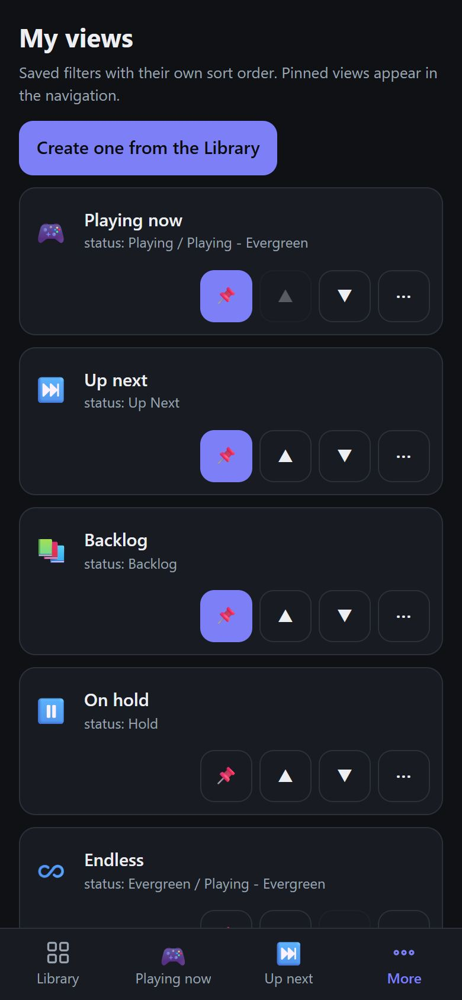

**Manage views.** Open **Views** (**More** on a phone, or the sidebar). For each view you can open it, **📌 pin** it to the bar and move it **▲▼**. The **⋯** button opens a small sheet with **Rename**, **Duplicate** and **Delete** (Esc, Close or Back closes it). After a delete there is an **Undo** for a few seconds.

## 7. Changing a game

Tap a card to open the game. On a phone, the **Back** button or swipe closes whatever panel is open (a game, a filter or sort sheet, a dialog) instead of leaving the page; if you have unsaved edits it asks first.

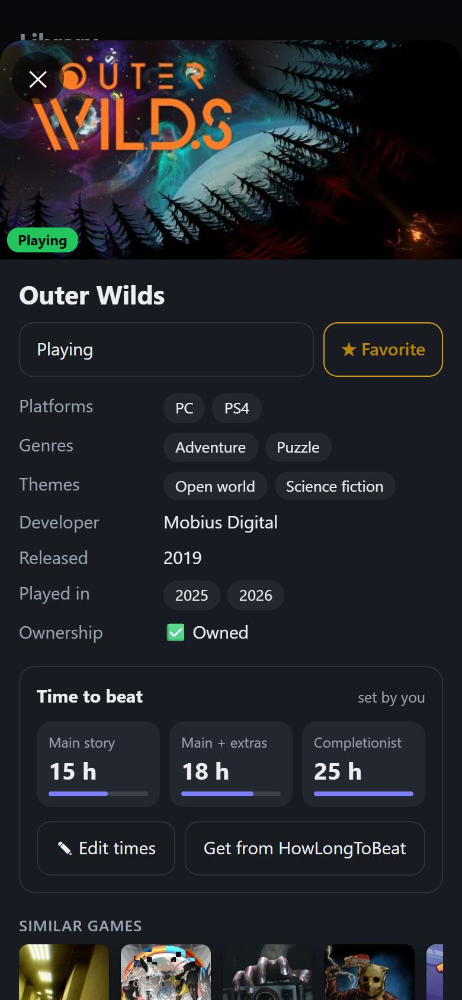

**Quick changes** (at the top, saved at once)
- **Status:** pick Playing, Playing - Evergreen, Up Next, Backlog, Hold, Evergreen, Finished, Dropped or Not Interested. A game that changes status goes to the end of your manual order.
- **★ Favorite** switches the favourite mark.
- **The year is added for you.** When you set a game to **Playing**, **Playing - Evergreen** or **Finished**, the current year is added to its years played (once).

**What IGDB adds** (for games linked to IGDB, see [section 22](#22-link-your-games-with-igdb)): the game's **Game modes** and **Perspective** appear in the details, and buttons for the game's **Steam**, **GOG**, **Epic Games** or **official site** page open in a new tab. These cannot be edited here; they are IGDB's.

**Time to beat.** The details have a **Time to beat** block with three tiles: **Main story**, **Main + extras** and **Completionist**, each with a small bar showing how long it is compared with the longest. A note says where the numbers come from: *from IGDB*, *from HowLongToBeat* or *set by you*. The times are not shown on the cards, only here (the **Time to beat** filter, Surprise me's **Quick game** and the backlog hours on Stats still use them).
- **✎ Edit times** opens three boxes. Type hours (`7.5`, `7,5`, `12`), hours and minutes (`7h30`, `1:30`) or minutes (`45m`); leave a box empty for no time. **Save** marks the times as *set by you*.
- **Get from HowLongToBeat** looks the game up by its title and release year and lists the matches with their three times. Tap the right one and its times are saved at once (you can still edit them afterwards). The search box lets you try another title when the game is not found. If HowLongToBeat cannot be reached (it has no official service, and it can be blocked or change without notice) the block says so and nothing else is affected: type the times yourself.
- Times you set or took from HowLongToBeat are **never replaced** by IGDB's later reads. Games with no time show "No time yet".

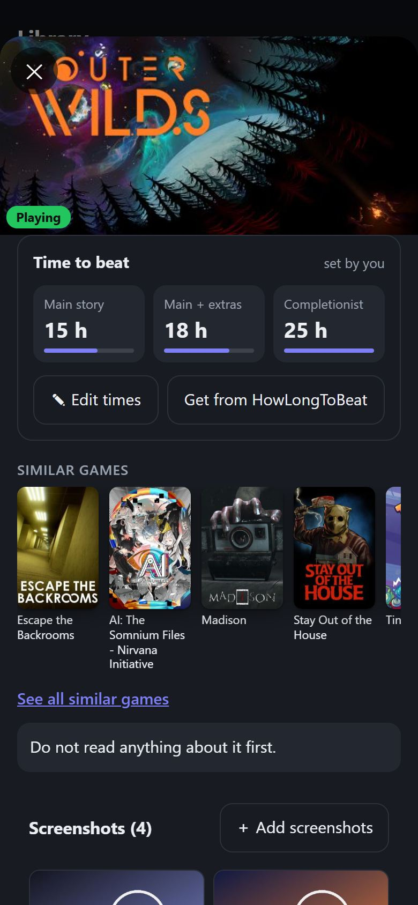

**Price, series and similar games.** Depending on the game, the details also show a **Price** line from IsThereAnyDeal with **Wrong game?** / **Pick the game** to fix the match ([section 17](#17-deals)), where the game falls in its series (for example **3 of 5 in Ace Attorney**, [section 14](#14-series)), and a small **Similar games** row for a finished or favourite game ([section 16](#16-similar-games)). These read what the pages saved earlier; opening a game never asks any website.

**Edit** changes everything else.

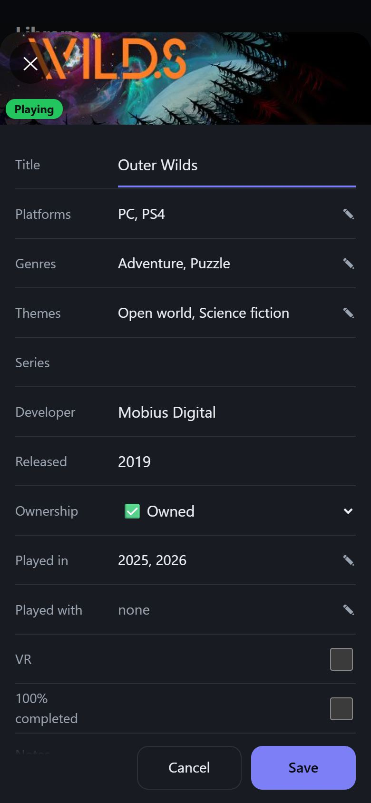

Tap **✎ Edit**. You can change the title, platforms, genres, themes, series, developer, release year, ownership, the years played, who you played with, VR, 100% completed and notes. Tap a list (like *Genres*) to open a sheet where you tick values and can type a new one. For **Played in** the list offers the years from the earliest one in your library to this year; type any other year (4 digits, from 1970 to 2100) to add it, or the periods *Childhood* and *Always*.
- **Save** keeps your changes. **Cancel** or the ✕ asks before throwing away unsaved edits.
- **Fill from IGDB…** looks the game up on IGDB, lets you pick the right match, and copies its genres, themes, developer, series and release year into the form. Your platforms, notes and ownership are not touched. Check the form, then **Save**. The game is then linked to IGDB (shown as *Linked to IGDB*, with **Unlink** if it was the wrong match). After saving a new link the app offers to update the rest of the details from the new game: see [Update the details after linking](#update-the-details-after-linking).

**Change cover** and **Change poster** are explained in [section 12](#12-covers-and-posters). **Delete game** removes the game for good, after a confirmation: its years, cover and screenshots go with it (the picture files are deleted too) and it cannot be undone.

## 8. Putting games in your own order

The *manual order* is how you rank games yourself, for example the order you plan to play your *Up next* games.

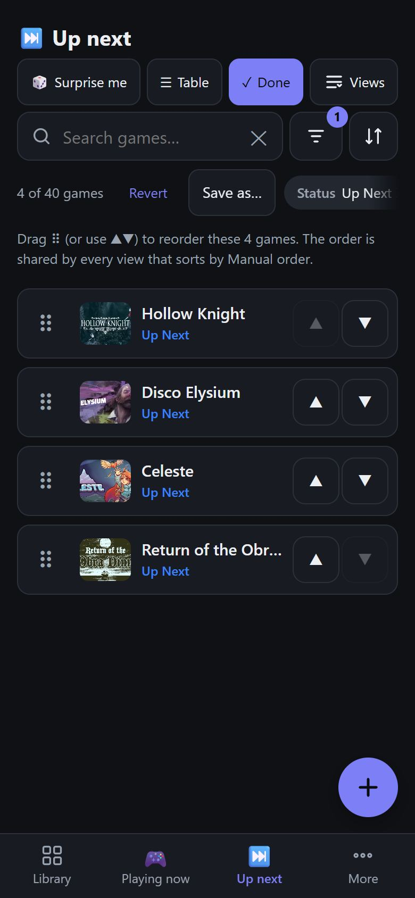

1. Open the view or the Library list you want to order (for example *Up next*).
2. Tap **⇅ Reorder** (on a phone, the three buttons *Surprise me*, *Table* and *Reorder* have their names under the title).
3. Drag the **⠿** handle to move a game, or use the **▲ ▼** buttons.
4. Tap **✓** (Done).

What to know:
- The order is saved as soon as you move a game.
- Only the games in the list are moved. Your other games keep their place.
- One order is shared by all views. A view shows it only when it sorts by *Manual order* (the default order, Status then Title, does not). Reordering always works on your manual order, whatever the view's sort is; to see the result in a view, add *Manual order* to its sort.

## 9. The table (spreadsheet) layout

Tap **☰ Table** (next to the title) to see your games as a table. Tap **▦ Cards** to go back. The layout is part of a saved view, so you can keep a table view of your backlog.

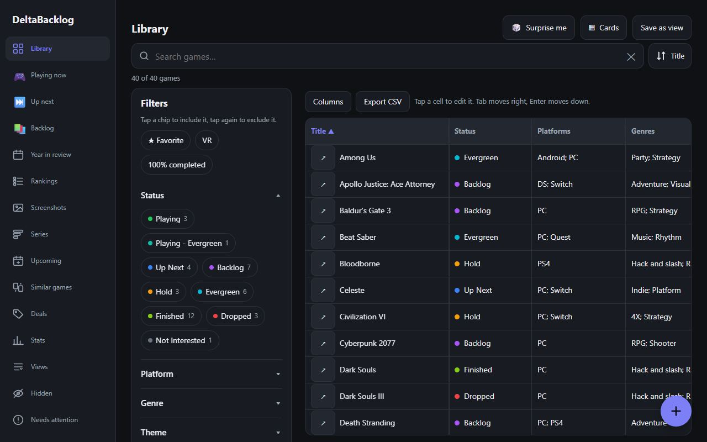

- **Sort** by tapping a column heading. Tap again to reverse it.
- **Resize** a column by dragging the edge of its heading.
- **Columns** lets you choose which columns to show (title, status, platforms, genres, themes, years played, series, time to beat, developer, released, ownership, played with, favorite, VR, 100%, notes, added). **Defaults** brings the original set back. Your choices are remembered on this device.
- **Keyboard (on a PC):** Tab goes into the table once; then the **arrow keys** move between cells, **Home** / **End** go to the ends of the row (with Ctrl, to the corners), **PageUp** / **PageDown** jump a page. **Enter** or **F2** edits the cell, **Space** toggles a checkbox cell, **Shift+Enter** opens the game. While editing, **Esc** cancels and puts the focus back on the cell.
- **Edit in place:** tap a cell and type. **Enter** saves and moves down, **Tab** saves and moves right, **Esc** cancels. Status is a drop-down, checkboxes toggle with one tap, and lists (platforms, genres, years...) open a sheet. Notes can have several lines (**Shift+Enter** for a new line).
- The ↗ button at the start of a row opens the game.
- **Export CSV** saves exactly the rows and columns you see as a file you can open in Excel or Google Sheets.
- On a phone the table scrolls sideways, with the title column kept in place.

## 10. Surprise me: let the app choose

Can't decide what to play? Tap **🎲 Surprise me** at the top of the Library or of any saved view (on a phone the buttons sit on their own row under the title, and that row scrolls away while the search box stays at the top). On a phone, **Save** and **Save as…** sit in the row under the search box (next to **Revert**), so the top row and the view name stay as they are.

**What it picks from.** The games that Library or view is showing right now, including your search and filters. With no filters at all it picks from your **Up next** games, or from **Backlog** if Up next is empty. Games that are Finished, Dropped, Not Interested, Evergreen are never offered, unless you filtered to that status on purpose.

**Your mood (optional).** A sheet opens first. Tap any of these to narrow the pick; the number on each chip is how many games would be left:
- **Platform** and **Genre**: tap one or more (a game needs to match any of the ones you tap in that row).
- **VR only**.
- **Quick game**: games that take under 10 hours to beat. It only appears once some game has a time to beat; games without a time are not offered by it.
- **Not played recently**: games you never played, or whose last year played is two or more years ago. A game you play "always" never counts.

If nothing fits, **Pick one** is greyed out and says so; remove a choice. Then tap **Pick one**.

**The result.** You see the cover, the title, platforms, genres and the years you played it (the time to beat is only in the game details), and three buttons:
- **▶ Play it** sets the game to *Playing* (the app records the current year for you) and closes the sheet. An Evergreen game becomes *Playing - Evergreen* instead, and a game you are already playing is left as it is (the button then reads *Already playing*).
- **Another one** shows a different game. It never shows the same game twice until you have seen them all; then it tells you and offers **Start over**.
- **Skip** is like *Another one*, and also leaves that game out for the rest of your browser session (until you close the tab). If you skip everything, **Forget my skips** brings back the skipped games that fit this pick (skips from other views stay skipped).

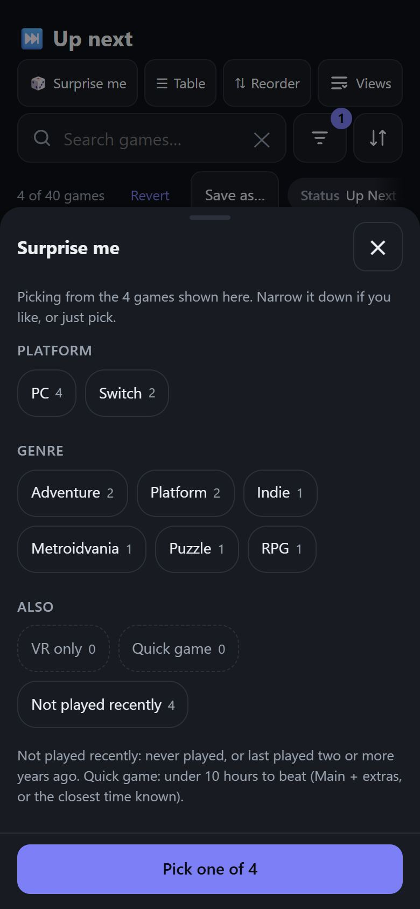

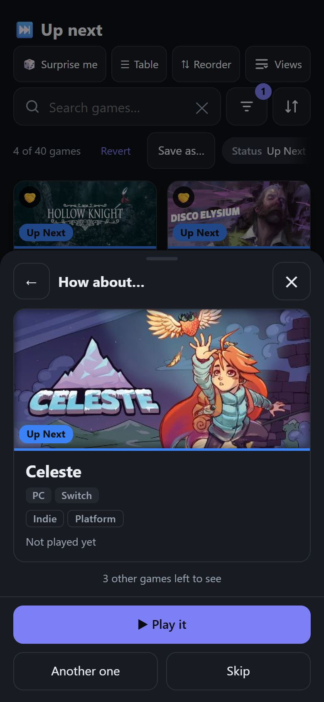

The **←** button goes back to the mood, and **✕** (or Escape) closes the sheet without changing anything.

## 11. Adding a game

Tap **+**.

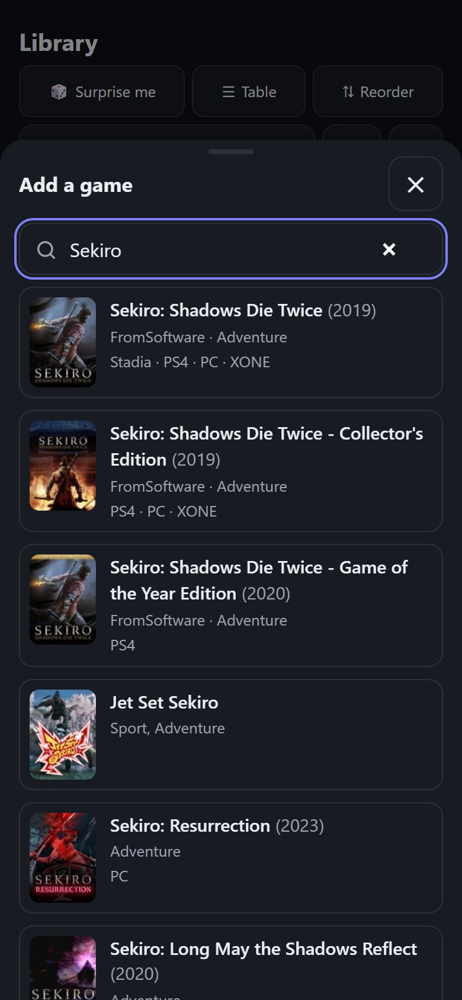

1. **Type the title.** After a moment you see matching games from IGDB, with cover, year, developer and genres. A match that is already in your library has an orange **Already in your library** label.
2. **Tap the right one.**
3. **Check the form.** Genres, themes, developer, series and release year are filled in for you. You choose the **status** (Backlog by default), the **platforms**, the **years played** (*Played in*), **played with** and the **ownership** (Owned by default). Tap **More details** for genres, themes, series, developer, release year, favorite, VR, 100% completed and notes: everything the game's Edit form has.
   - **Years played:** the list runs from the earliest year already in your library to this year, plus *Childhood* and *Always*. For an older year, type its 4 digits in the box at the top of the list and tap *Add*. A game added as Playing, Playing - Evergreen or Finished also gets the current year, once.
   - **Platforms:** the platform you play most among the ones the game is on is selected for you (for a PC game that is PC). The other platforms IGDB lists appear as chips: tap one to add or remove it.
   - **Cover:** a row of pictures from SteamGridDB appears. The first is chosen. Tap another one, or **No cover**. **Search again** looks again with the title you typed.
4. **Add to library.** The game is added at the end of your manual order and opens so you can adjust it.

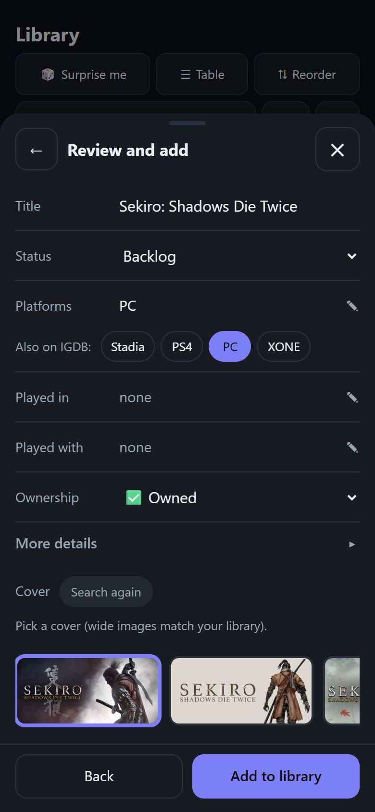

If the game is not found, tap **Add "..." without a lookup** to type everything in yourself. The lookups need IGDB and SteamGridDB keys ([section 3](#3-setting-up-keys)); without them you can still add games by hand.

The add form also opens, already filled in, from other pages: **Add** on Similar games, Upcoming and the Series page. You always choose the status, platforms and the rest before **Add to library**; nothing is ever added without you.

## 12. Covers and posters

Open a game and tap **Change cover**.

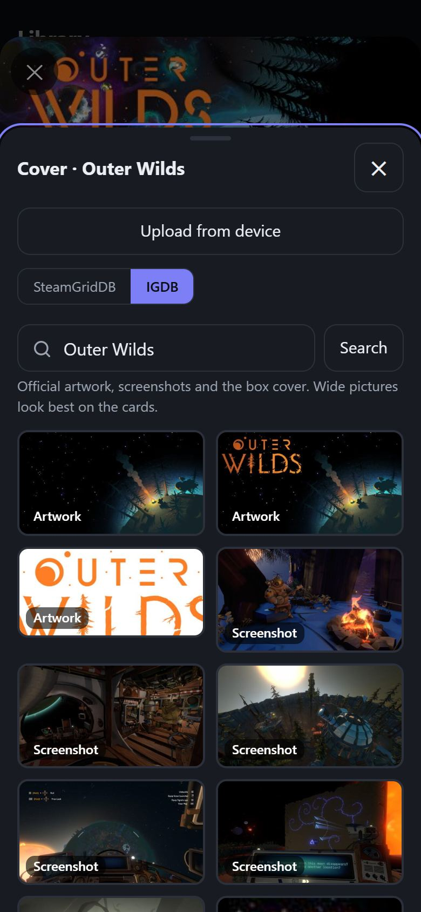

- Two tabs: **SteamGridDB** (community covers; wide pictures match your library) and **IGDB** (official artwork, screenshots and the box cover, each labelled). The tab you used last is remembered.
- The search box starts with the game's title. Type another title and tap **Search** when the automatic match is the wrong game.
- Tap a picture to use it. It is saved on your Raspberry Pi, so the app does not depend on those websites afterwards.
- Cards show the cover as a wide picture, so wide images look best.
- **Upload from device** uses a picture from your own phone or computer (on a phone it opens the photo picker or the camera). JPEG, PNG or WebP. A big photo is shrunk (and turned the right way up) on your phone before it is sent, so a camera photo is fine; the app says so when a file is the wrong type, too big or damaged. The picture is shrunk and saved on the Pi like any other cover, and nothing ever replaces it on its own.

### The poster (portrait picture)

The Series, Upcoming, Similar games and Deals pages and the rankings (and their PNG) use a **portrait poster** of each game, made for you automatically. A wrong poster is the usual thing to fix here: for example a game that is not linked to IGDB can get a look-alike from SteamGridDB. To choose your own, open a game and tap **Change poster**, or, on a ranking board, tap a game and then the picture button in the bar at the bottom.

- **IGDB** shows the official box cover and **SteamGridDB** shows several community portraits. Tap one to use it. Both lists load on their own: if SteamGridDB cannot be reached right now (some providers block it at times) its part says so and the IGDB cover is still there.
- **Upload from device** uses a portrait picture from your own phone or computer (JPEG, PNG or WebP; photos are shrunk and turned upright first). The middle of the picture is cut to a 2:3 poster, so choose one that is already tall.
- **Paste an image link** uses a picture from the web. Only links from the same sites as covers (IGDB and SteamGridDB images) are accepted.
- **Crop of the wide cover** cuts the middle of the game's wide cover into a portrait (no internet needed). **Fetch automatically again** goes back to what the app chooses by itself (IGDB, then SteamGridDB, then the crop) and replaces your pick.
- **Linking the game to another IGDB game updates the poster.** When you change a game's IGDB link (in its details or on the Link screen), the app fetches the new game's poster by itself (IGDB, then SteamGridDB, then the crop) and replaces the old one. If IGDB cannot be reached at that moment, the app tries again by itself a little later. Removing the link leaves the poster as it is.
- A poster you chose or uploaded stays: the app never replaces it on its own, also not when the IGDB link changes, and changing the wide cover does not change it. The ranking board and the exported PNG show the new poster at once.

## 13. What the little icons mean

**Ownership** (filters, the table, the game's details and a badge on cards):

| Icon | Meaning |
|---|---|
| ✅ | Owned (shown on cards only for the other kinds, to keep them calm) |
| 🏴‍☠️ | Pirated |
| 🆓 | Free to play |
| 👨‍👩‍👧 | Family share |
| 🤝 | Borrowed |
| 🚫 | Nope |
| 🏷️ | Any other value you add yourself |

**Years played on a card:** 🧒 childhood · ♾️ always played · a dashed **+N** older years not shown.

## 14. Series

*Needs IGDB for the games you do not have yet; the progress itself needs nothing.*

Open **Series** in the navigation (**More** on a phone) to see how far you are through every series. Each series is a tile: a fan of its posters, its name, a progress bar and *2/4 finished*. Tap a tile to open the series on its own page (the phone's back button returns to the tiles): its games are posters in release order, with a line such as *3 finished · 4 played · 5 games · 1 left to play*. Tap a poster to open the game's details. A green ✓ on a poster means finished, a ▶ means played; posters of games you have not played yet are a little paler. A tile's fan shows up to four posters, preferring games linked to IGDB. If a game has a wrong poster, open the game and tap **Change poster** ([section 12](#the-poster-portrait-picture)). A game with only a wide cover shows it whole on a dark background instead of cropped.

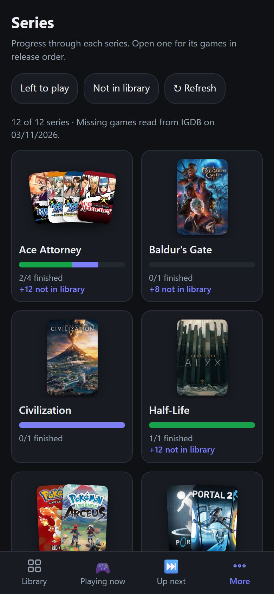

- **Finished** means the game's status is **Finished**.
- **Played** means you have started it: it is Finished, or its status is Playing, Playing - Evergreen, Evergreen, Hold or Dropped, or it has any year (or Childhood / Always) in *Played in*. Finished games count as played too.
- **Left to play** means a game you have not played yet (for example Backlog or Up Next). Games marked **Not Interested** are not counted as left to play, but they still count in the total.
- The bar is green for finished games, in the accent colour for games played but not finished, and grey for the rest.
- **Completed ✓** marks a series whose games you have all finished: a small green *Completed ✓* under the progress and a green outline. Games that are not in your library (the *Not in your library* ones, hidden or not) never count. A game in your library with the ownership **Nope** (one you do not have) is ignored while it is not finished.
- **Search and filters.** The search box finds a series by its name or by the title of any of its games. **Filters** (a side panel on a PC, a sheet on a phone, with **Reset** and *Show N series*) has **Progress** (*Completed*, *In progress* = you played something but have not finished everything, *Not started*), **Show** (**Left to play** hides series where nothing is left; **Not in library** shows only the series that have a game you do not have yet, see below) and **Platform**. Every chip shows how many series it would give. The sort button orders by name, **% finished**, number of games or **last played** (the latest year played of any of its games; never played last). Everything is kept in the address, so reloading, sharing the link, or coming back from an opened series keeps it.
- Games are listed by **release year** (games without a year come last), then by title. There is no "number in the series": the release year puts a game in its place. Games imported from another tool usually have no year yet: open a game, tap **✎ Edit** and **Fill from IGDB…**, and the year is set. The page tells you how many games still have no year.
- A game's details show where it falls, for example **3 of 5 in Ace Attorney**, only when every game of that series has a release year (otherwise they show *Ace Attorney (5 games)*, because the order would be a guess). It appears only for series with at least two games. A series is every game with the same series name; capital letters do not matter.

### Games you do not have yet ("Not in your library")

An opened series also shows the games of the same IGDB collection that are not in your library, in release order among yours. They appear greyed, with a dashed outline, the label **Not in your library**, and two buttons. When the series has more than six of them, only the first six are listed, with **Show all** under the games to see the rest:

- **Add** opens the add form already filled in from IGDB (genres, developer, release year, cover, and the series name you use). You choose the status, platforms and the rest, then **Add to library**. The game then disappears from the not-in-your-library list by itself.
- **Hide** removes the game from this list for good (for example a spin-off you will never play). A message offers **Undo**; hidden games are listed under **Hidden (n)** at the bottom of the series, each with **Show again**. Everything you hid on Series, Similar games and Deals is also on the **Hidden** page ([section 17](#the-hidden-page)).

Only real games are listed: DLC, expansions, bundles, ports, updates, mods, episodes and seasons are left out; remakes and remasters are kept. Games are matched by their IGDB link, and a game counts as yours with its other IGDB entries (the original and the remaster of a game you own are not listed), so a game you have not linked to IGDB can show up here too (use **Link IGDB** to link your games first).

Which IGDB collection belongs to a series is decided by your linked games: the series *Souls* with Dark Souls linked gets Dark Souls' collection, whatever IGDB calls it. When your games belong to several collections, the one most of them share is used (and, on a tie, the one named like your series). A series with no game linked to IGDB shows nothing. Big series (Pokémon, Mario) can list dozens of games: hide the ones you do not care about.

The lists are saved on the server and are **not** read when you open the page. Tap **↻ Refresh** to read them from IGDB (it takes about half a minute for a big library and keeps going if you leave the page); the page says when they were last read. See [section 23](#23-refresh-buttons).

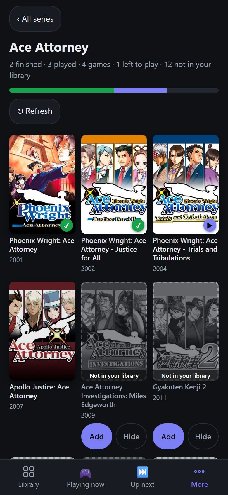

## 15. Upcoming releases

*Needs IGDB for the dates.*


**Upcoming** lists the games that are not out yet, grouped by month: **This month**, **Next month**, then the months after. A game IGDB only dates to a quarter or a year sits after the months it covers as **Q3 2027** or **2027**, and is never shown as a specific day. **Later / TBA** holds games with no announced date and releases more than a year and a half away. Each row has the poster, the title, the date, the platforms IGDB lists and the series it belongs to. The games are the **new games of your series** that are not in your library (the same games as *Not in your library* on the Series page). They have **Add** (the add form pre-filled; you choose the status) and **Hide** (the same hide list as the Series page, with Undo).

A **Recently released** section at the top shows games that came out in the last 60 days, so a new game of a series that just launched does not go unnoticed. Older releases leave the page; a game you own is never listed. Dates are written in English (for example *5 Nov 2026*) whatever your browser's language.

The dates come from IGDB and are saved on the server. Opening the page never asks IGDB: tap **↻ Refresh from IGDB** (the same background run as on the Series page). Games you add or link to IGDB get their date at once. Dates are shown as IGDB's calendar date, whatever your time zone.

**Hide** on a row takes the game off Upcoming and the Series page (they share one list); it is also listed on the [Hidden page](#the-hidden-page), under Series, where **Show again** brings it back.

**Search and filters.** The same toolbar as the Library: a search box (title or series), and **Filters** with **When** (*This month*, *Next 3 months*, *This year*, *Later*, *TBA*; a date that covers several months, such as a quarter or a year, counts for each month it covers; games already out are only under *Recently released* and leave the page when a *When* chip is on), **Series** and **Platform**. The chips show how many games each would give, and the filters are kept in the address.

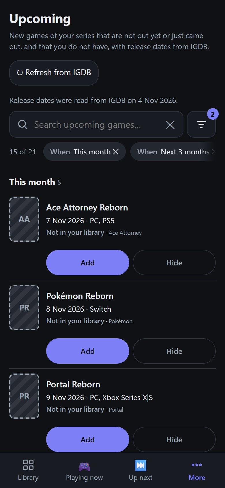

## 16. Similar games

*Needs IGDB.*

**Similar games** suggests games you do not have yet, taken from IGDB's own "similar games" lists of the games you **finished** or marked as a **favourite** (a game must be linked to IGDB for that, see [section 22](#22-link-your-games-with-igdb)). The more of your games suggest a game, the higher it sits; between two games with the same count, the one suggested by the game you played most recently comes first. Each row has the poster, the title, the year and *Because you played X, Y and Z* (up to three of your games, then *and 2 more*), and two buttons:

- **Add** opens the add form, pre-filled from IGDB; pick the status you like there.
- **Hide** removes the game from the list for good (an **Undo** shows for a few seconds). **Hidden** at the bottom of the page lists them, each with **Show again**. This is its own list: hiding a game here does not hide it on the Series page, and the other way round. The **Hidden** page ([section 17](#the-hidden-page)) lists them together with the games hidden elsewhere.

The page follows the same ownership rule as the Series page: a game you own is not suggested, and neither is another version of it (a remaster, an expanded edition or a port of a game you have). A remake or a standalone expansion of a game you have still is.

The suggestions are saved on the server. Opening the page never asks IGDB: tap **↻ Refresh from IGDB** to read them (a few requests in the background, with progress; it can be left and takes about a minute for a large library). A game's details also show a small **Similar games** row for a finished or favourite game, from the same saved list.

**Search and filters.** The toolbar has a search box (by title), **Filters** and a sort button. The filters are **Genre**, **Platform**, a **Release year** range (from, to; a game with no year is outside any range), **Because of** (the games of yours that suggested it) and **Games you hid** (*Include the games I hid*: they are left out by default; when included they come last, marked *Hidden*, with **Show again**). Genres and platforms are read from IGDB with the suggestions: after updating, tap **↻ Refresh from IGDB** once to fill them in. The sort is **Number of sources** (the order described above), **Year** (newest first) or **Title**. The filters are kept in the address.

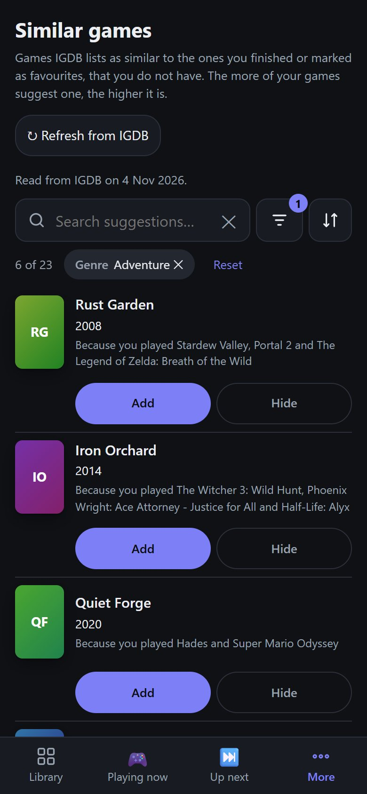

## 17. Deals

*Needs an IsThereAnyDeal key ([section 3](#3-setting-up-keys)). Games are matched through their Steam store link (from IGDB) or exact title.*

**Deals** shows what the games you **don't own and haven't played yet** cost right now and how that compares with the lowest price they ever had, from [IsThereAnyDeal](https://isthereanydeal.com). Games on sale come first, biggest discount first; then the games that are not on sale but are at or near their historical low. A game gets a **Historical low** badge when its price is at (or under) the lowest ever recorded, and **Near low (within 10%)** when it is at most 10% above it. The badges only appear when that low was a real discount or the game is on sale now: a game that has always cost its full price has none. Each game is one compact row, like SteamDB's sales list: a small picture, the name with small tags (**Historical low**, **Lowest in 2 years**, **New**), a green discount box (**-75%**), the price and the regular price struck through, and a muted line with the lowest price ever and where it was. A game with no cover of its own, but a Steam link, gets its Steam picture. A coloured bar on the left marks the games at their historical low (green) or with another alert (orange). **Tap a row** to open its actions: **View deal ↗** (the shop page, in a new tab), **Open game** (the game's details), **Mute price alerts** and **Hide from Deals**. On a PC the list is a table with the columns *Name, Discount, Price, Lowest ever, Shop, Ends* (and *Added* on the wishlist): the page uses the whole width like the Library, the name takes the room that is left, and *Shop*, *Ends* and *Added* appear when the list is wide enough. Click a column header to sort by it, click it again to reverse; the sort button next to the search box does the same on any screen.

**Search and filters.** Deals has the Library's toolbar: a search box (it finds titles as you type; press `/` to jump to it), a **Filters** button with a count of the filters that are on (a side panel on a PC, a bottom sheet on a phone) and a sort button. The panel has the same chips as the Library, each with the number of games it would show: **Status** (Backlog, Up next; the library list only), **On sale**, **Alerts**, **Ends within 3 days**, **Added in the last 30 days** (the wishlist only), **Minimum discount** (any, 25%+, 50%+, 75%+), **Maximum price** (under 5, 10, 20 or 40 in your currency), **Low price** (Historical low, Lowest in 2 years, Near low) and **Store** (the stores the listed games have). **Reset** clears them, **Show N games** closes the sheet. Every active filter is also a pill under the search box: tap it to remove it. The filters are in the address (for example `#/deals?view=wishlist&min=50&sale=1`), so a reload, Back and a bookmark keep them. Under **Library / Wishlist** (right below the title) the two lists have the same filters. The page head has **↻** to refresh the prices with *Checked 16:56* next to it, and the **i** button explains the page and holds **Preferred stores** and the Telegram test. The country code is in the filter panel (*Prices for*).

**Which games are listed.** A game is on Deals when both are true: you don't own it, meaning its *Ownership* is **Borrowed**, **Family Share** or **Nope**, or it has none (**Owned**, **Free to play** and **Pirated** games never appear); and you haven't played it, meaning it is in the **Backlog** or **Up next** and has no years played (not even *childhood* or *always*). Finished, dropped, playing, on hold, evergreen and not interested games are left out. When you change a game so that it no longer fits (you buy it, or log a year of play), it leaves the page and is no longer refreshed; its saved match and prices are kept in case it comes back.

**Price alerts.** Deals tells you when a game is worth buying, with no price to set. A game gets an **alert** when its best price, on sale, is **at or below its historical low** (the lowest ever recorded) or, failing that, **at or below its lowest price of the last 2 years**. The alert says which one: **Alert: Historical low** or **Alert: Lowest in 2 years**. In the app:

- The **Alerts** chip shows only the games with an alert, with their count. An alert lasts while the game stays at that price or lower.
- A game with a new alert you have not seen is marked **New** the first time you open Deals, and **Deals** carries a small number in the **More** menu (in the sidebar on a PC) until you do.
- **Mute price alerts** in a row's actions, or **Price alerts: on / off** in the game's **Price** details, turns the alerts of one game off or on again. A muted game is never announced.
- You are told once per deal: again only when the price falls below the one you were told about, or after 30 days.

**Telegram.** To get the alerts as a message on your phone too, put `TELEGRAM_BOT_TOKEN` and `TELEGRAM_CHAT_ID` in the settings file ([section 3](#3-setting-up-keys)) and restart the app. Deals then shows **Send test message** in its **i** panel (the round button next to the title): press it to check that the message arrives. A single run sends one message per game, or one list when more than three games have an alert. A message looks like this:

```
🔥 Historical low
Celeste
€4.99  €19.99 (struck through)  −75% at Steam
Lowest ever before: €5.99 (12 Mar 2025)
View deal
```

🔥 is a historical low and 📉 the lowest price in 2 years (that message shows the historical low as a reference). A wishlist game adds *💙 Wishlist* to the first line and shows the large preview of its Steam store page; other messages have no preview. A list of more than three games starts with *🔔 N price alerts* and a key to the emojis, then your library games under *📚 Your library* and your wishlist games under *💙 Your wishlist*. Each game takes two lines with a blank line between games: the kind and the title (a link to the deal), then the price, the regular price struck through, the cut and the store (*€12.49 ~~€24.99~~ −50% at Steam*). **Send test message** sends a short "DeltaBacklog is connected" note followed by an example alert. Without these settings the alerts only appear in the app.

**Preferred stores.** If you like some shops better than others (Steam over the Microsoft Store or Epic, say), open the **i** panel and press **Preferred stores**. In the sheet, add shops (the box suggests the shops IsThereAnyDeal knows for your country), put them in order with the ↑ and ↓ buttons (the first is your favourite) and remove the ones you do not want. Deals then shows the price at the highest-ranked shop that sells the game, not the cheapest one; shops you did not list come after yours, cheapest first, and if none of yours sells the game you get the cheapest price. When another shop is clearly cheaper, the row adds a small line such as *€9.99 at Epic Game Store* (under the name on a phone, below it on a PC; the action sheet has a link to that offer). "Clearly" is the percentage at the bottom of the sheet (15 by default: the other shop has to be more than 15% cheaper). Price alerts, and the Telegram messages, follow your ranking too: a historical low that exists only at a shop you rank lower does not alert you, and a message that has a cheaper offer says so in brackets after the price, for example *at Steam (€9.99 at Epic Game Store)*. Sorting by price uses the price shown. The new ranking applies the next time you press **↻ Refresh prices** (or the scheduled check runs); with an empty list everything works as before. The ranking uses one extra request for up to 200 games at each refresh.

**The check every 6 hours.** On the Raspberry Pi a timer reads the prices every 6 hours (about 02:00, 08:00, 14:00 and 20:00, each with a small random delay) and sends the alerts, so you do not have to press anything: the alerts and prices are there when you open Deals. It does the same as **↻ Refresh prices**, for the games on the page (not the hidden ones), and does not run together with a refresh you start by hand: it waits up to 20 minutes for yours to end (and **Refresh prices** says so if the scheduled check is running at that moment). If Telegram cannot be reached, the alert is still in the app and is sent at the next check. On a PC, run `deltabacklog deals-check` yourself, or from your own scheduler.

**Your Steam wishlist.** If you set `STEAM_ID` ([section 3](#3-setting-up-keys)), Deals gets two buttons under the title: **Library** (everything above) and **Wishlist** (your Steam wishlist, with its count). The wishlist is **not part of your library**: its games have no status, never appear in the Library, views, stats or series, and this is not the old *Wishlist* status. A wishlist row looks like a library row (the best price now, the historical low, the same tags, **Alerts**, **Mute** and **Hide**) and its actions add **Add to library**, which opens the normal add form with the title, so you choose the status and ownership, and **Steam page ↗**. Its picture is Steam's small capsule art: the app downloads it once during **↻ Refresh prices** (a few requests for the whole list; a game that has its picture is never asked about again) and serves it from your own server, so your browser never talks to Steam's servers; a game without one shows coloured initials. Once the game is in your library the row disappears from the wishlist (it is matched by Steam link, by its IsThereAnyDeal game or by its title), and from then on it is listed as a library game only if the rule above applies to it. A game you buy leaves your Steam wishlist, so it leaves this list the next time you press **↻ Refresh prices** (or the scheduled check runs). The wishlist is read from Steam only then, never when a page opens, and price alerts, including the Telegram messages (marked *💙 Wishlist*), work like those of the library games.

**Making your wishlist public.** Steam only shares a public wishlist. In Steam open *your name → View my profile → Edit Profile → Privacy Settings* and set **Game details** to **Public** (and, if you use it, make sure the wishlist itself is not hidden). If Steam sends nothing, Deals says *Steam sent no wishlist games: the wishlist is empty or not public* under the buttons and keeps the list it had, so a private or empty wishlist never wipes it. Steam answers a private wishlist and an emptied public one the same way, so when you buy or remove the **last** game on your wishlist, Deals cannot tell and keeps showing the old list; hide the leftovers with **Hide**, or add a game to your Steam wishlist and refresh, and the list follows Steam again. A game IsThereAnyDeal does not know is listed under *No match on IsThereAnyDeal* and tried again after a week. The first run looks up each wishlist game once (about 0.4 seconds each, 130 games take about a minute); if IsThereAnyDeal asks you to slow down, the run stops with what it saved and the next one carries on.

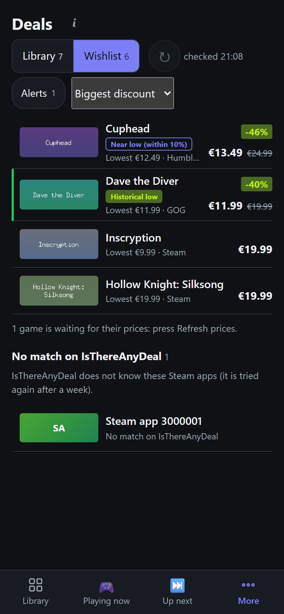

**Hiding a game.** Tap a row, then **Hide from Deals**, to take a game off the page; a message offers **Undo**. A hidden game is not shown and not refreshed, so it costs no lookups. **Hidden (N)** at the bottom of the page lists them: tap it, then **Show again** to bring one back.

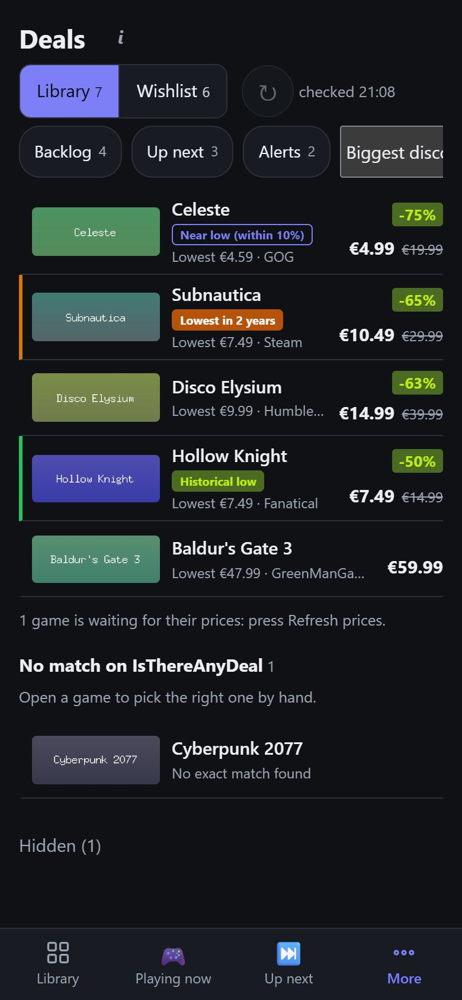

On a PC the same list is a sortable table:

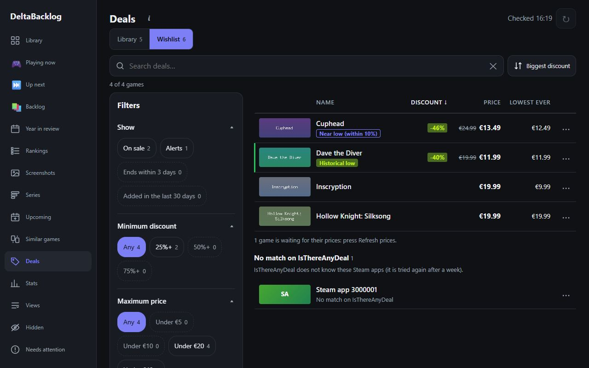

Prices are saved on the server. Opening the page never asks IsThereAnyDeal: tap **↻ Refresh prices** to read them (a background run with progress). The first run, and any game you add later, needs one or two lookups per game to find it on IsThereAnyDeal (about 0.4 seconds each, so a few minutes for a few hundred games); after that a refresh needs about one request per 50 games. *Checked 16:56* next to the refresh button tells you how old they are (a time today, a date and time before). Prices are for one country, shown in its currency: **Prices for** (two letters, `ES` by default, in the filter panel) can be changed on the page; the saved prices are then dropped, and you press **Refresh prices** to read them for the new country.

**Fixing a match.** A game is matched with IsThereAnyDeal by the Steam store link in its details when it has one, otherwise by its exact title. When there is no exact match the game is listed under **No match on IsThereAnyDeal** instead of guessing. Open it and use **Pick the game** (or **Wrong game?** when the match is wrong): search by title, tap the right game, or choose **No match on IsThereAnyDeal**. Your choice is kept; **Match automatically** gives control back. The same **Price** line appears in a game's details. A game that is matched but that no shop lists right now is named in a short note under the list: it is often an old or delisted entry (for example a game and its *Final Cut*), so open it and tap **Wrong game?**.

### The Hidden page

**Hidden** (**More** on a phone, near the bottom, or the sidebar) is one list of everything you hid: **Deals**, **Similar games** and **Series** (also what you hid on Upcoming), each group with its count (a group with nothing hidden is not shown). A compact row (like Deals) has the cover, the title, where it came from (*Because you played X* for a suggestion, your series name for a series game) and the date it was hidden, with a small **Show again** button at its end. **Show again** puts the game back on its page and offers **Undo**. The Hidden (N) lists on those pages stay as they are. The toolbar's search box looks in the title, the series name and the *Because you played* text, and **Filters** has **Source** (*Deals*, *Similar games*, *Series*). The page reads only what is saved on the server, so opening it never asks IGDB or IsThereAnyDeal.

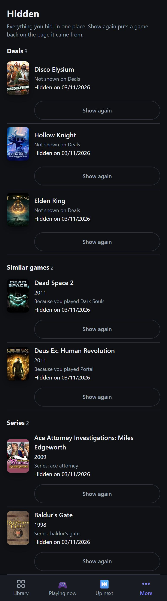

## 18. Stats

Open **Stats** in the navigation (**More** on a phone). Everything is worked out from the games you already have; nothing is stored.

The top has four tiles (games, finished, estimated hours finished, estimated hours left) and a row of buttons that jump to a section. On a phone the row stays under the top of the screen while you scroll, and the button of the section you are reading is highlighted.

**About the hours.** Every hours figure is an estimate and says how many games it rests on, for example *≈ 1,240 h across 142 of 189 finished games*. A game's time is its **Main + extras** time to beat; when it has none, the quickest time, then the complete one (whatever the source: IGDB, HowLongToBeat or typed by you). Games with no time to beat add nothing, so the real figure is higher; the page says how many games that is and links to **Needs attention**, opened on the list that holds them. Only games that need a time are counted: Finished, Backlog, Up next and Playing. Dropped, Evergreen and Hold games are not estimated, and are not listed as missing a time either. A game you marked **No time on HowLongToBeat** is counted as *no time exists* (for example *the other 12 have no time to beat (3 have none on HowLongToBeat)*), not as missing. It is how long the games take to beat, not how long you actually played them.

- **Time spent finishing games**: the estimated hours of all the games with the status Finished, and the genres and platforms (top six) where those hours went. A game with several genres or platforms counts for each, so the groups overlap.
- The tile **≈ N h left to play** adds up the estimated hours of **Up next** and **Backlog** (Hold, Playing and the rest are not counted); it follows the same rule.
- **Year by year**: a chart of games played (every year in a game's *Years played* counts, so a game played in three years is in three bars) and games finished (each finished game once, in the last year you played it), the most active year, and a second chart with the estimated hours of the games finished each year (years with finished games lacking a time are underestimated, and the page says which). Games played in *Childhood* or *Always* are not a calendar year: they are counted under the chart, never put in a year. Finished games with no year at all are mentioned too. Under the charts, the numbers are also in a table for screen readers.
- **Backlog**: how many games are on the backlog or up next, and how many per platform (a game on two platforms counts for both).
- **Shortest wins**: the 10 shortest games in Backlog or Up next that have a time to beat. Tap one to open it.
- **Finished or dropped**: the share of games you finished against dropped, and the same per genre and per platform. Only groups with at least 5 finished or dropped games are listed; the percentage is the share finished (*5/6* is finished out of finished plus dropped).
- **Library**: your games by ownership, by platform (top eight) and by release decade (games with no release year are mentioned).
- **Series**: of the series that have at least two games in your library, how many are completed (every game finished), in progress and not started, and the three closest to done. Games of a series that you do not have are not counted.
- **Time waiting**: for Backlog, Up Next and Hold, the typical and longest time since a game was last changed, and the five games that have waited longest (tap one to find it in the Library). This is a rough guide: any edit resets the clock. Games you have not touched since the import are left out (the card says how many), and until the rest were changed over at least a week it tells you there is nothing to compare yet. The line about how long the waiting games have been in your library (typical) uses the *added* date and leaves out the games of the import (the games all changed at the same moment, detected automatically), because an imported game's added date is the import day, not when you got it.
- **Most played genres**: genres of the games you have played (a year or period recorded, or a status such as Playing, Finished or Dropped).

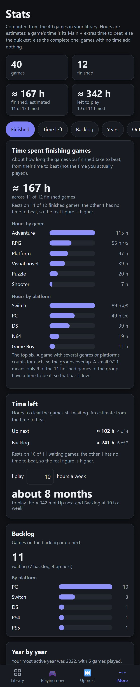

On a desktop the cards use two columns:

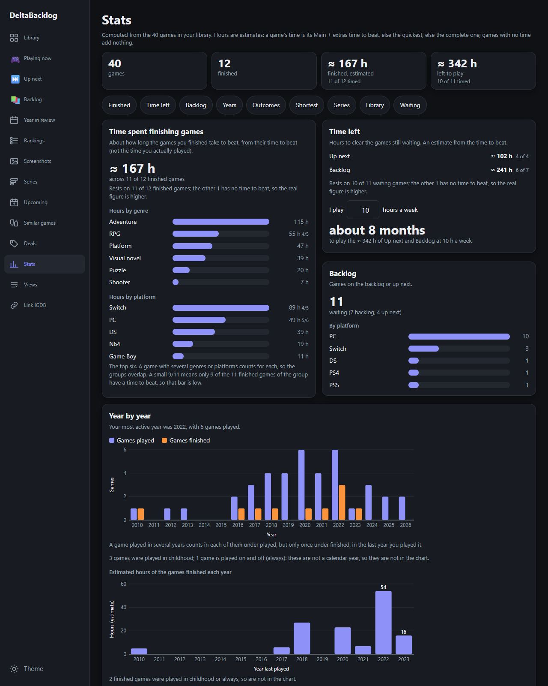

The charts have text labels and work in light and dark. Screen readers get the numbers as a table.

## 19. Year in review

**Year in review** opens the latest year you played something. A game belongs to a year when that year is in its *Years played* (moving a game to Playing or Finished adds the current year by itself). Childhood and "always played" do not count as a year.

- **The page.** The big **‹** and **›** buttons go to the previous and next year (one calendar year at a time, so a year with no games is reachable too; it says nothing was recorded). The strip under the title jumps to any year, with the number of games.
- **Counts.** Games are grouped by their *current* status: **Finished**, **Dropped**, **Still playing** (Playing and Playing - Evergreen) and **Played** (everything else, for example Evergreen or Backlog). Next to them are the platforms and genres you played that year. Tap any game to open its details.
- **Rank this year** opens the ranking of that year, or makes it with that year's games waiting to be ranked (see [section 20](#20-rankings)).

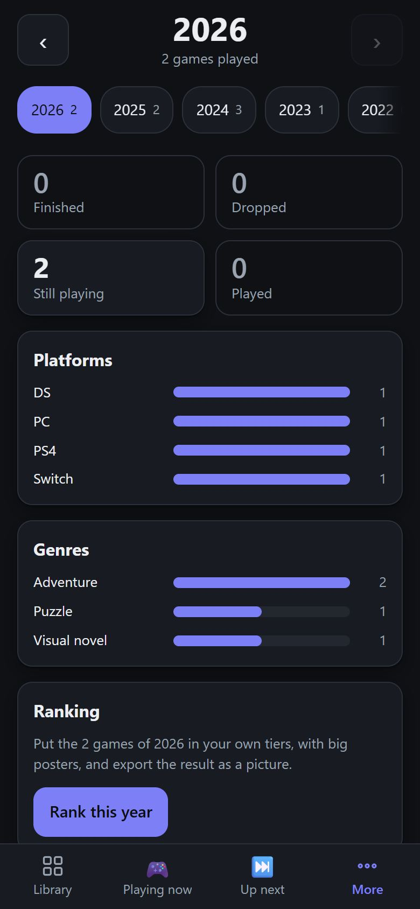

## 20. Rankings

**Rankings** are lists like the ones you make on TierMaker: as many as you want, each with its **own tiers**, **your own labels** ("Me ha cambiado la vida", "Vaya mierda"...) and colours, and big **poster** pictures of the games. A ranking can hold any set of games: everything you played in 2025, all your RPGs, a hand-picked handful.

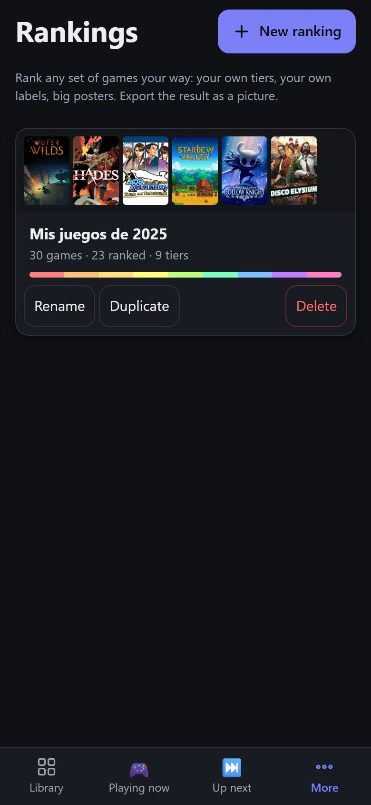

- **The list.** With at least one ranking, a search box finds rankings by name or description (kept in the address, `#/rankings?q=best`; the arrows to reorder are hidden while a search is on). **New ranking** asks for a name and the starting tiers: **S to F** or **Empty** (you make the tiers). Each ranking shows its best games, how many games it has and its tier colours. Under it: move it up or down (the arrows appear only when you have more than one ranking, and not at the end where they cannot go), rename, duplicate and, apart on the right in red, delete (after a confirmation; the games stay in your library). The old per-year tier lists became rankings called *Tier list 2025*, *Tier list 2024*... with the same tiers and games.
- **Add games.** The button opens your whole library with search and the same filters as the Library page. Tick games one by one, or filter (for example *Year played: 2025*) and tap **Select these** to take every match at once, then **Add**. New games wait in **Not ranked**, below the board. The first time a game joins a ranking its poster is fetched in the background (a few seconds each; the page fills them in by itself). Until then the wide cover is shown.
- **Move a game.** On a PC drag it with the mouse. On a phone **press and hold** until it lifts, then drag (near the top or bottom edge the page scrolls by itself). Or **tap a game** to select it: the bar at the bottom has **◀ ▶** (earlier or later in its tier), **▲ ▼** (one tier up or down), *Not ranked*, *Details* and *Remove from this ranking*, and with a game selected you can also **tap a tier** to put it there. With the keyboard: Tab to a game, **Enter** selects it, the **arrow keys** move it (left and right inside the tier, up and down between tiers), **Esc** lets go. Without a selection the arrows just move between games.
- **Tiers.** **Tap a tier's name** (with nothing selected) to change its **label** (up to 80 characters, it wraps), its **colour** (a palette or any custom colour), move it up or down, **duplicate** it or **delete** it (its games go back to *Not ranked*; **Undo** in the message at the bottom brings it back). **Add tier** adds a new one at the end; the menu **⋯** can add the classic S to F tiers.
- **Change a poster.** Tap a game and then the picture button in the bar at the bottom: see [The poster](#the-poster-portrait-picture).
- **Look.** **S / M / L** change the size of the posters and **Titles** writes the game name on each poster (on a PC hover a game to see its name; on a phone tap it and the bar at the bottom shows it). Both are remembered on this device. The title and the **⋯** menu (rename, description, duplicate, delete) are at the top.
- **Export PNG** saves the board as a picture (dark background, tier labels, full-size posters; the *Not ranked* games are left out), named after the ranking.
- Everything is saved automatically. Opening a year's ranking from **Rank this year** also adds the games that got that year since (a game you removed from it comes back too); renaming the ranking does not break that link.

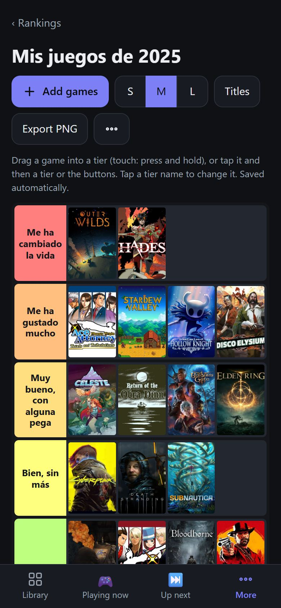

On a PC the same board has room for many posters per row:

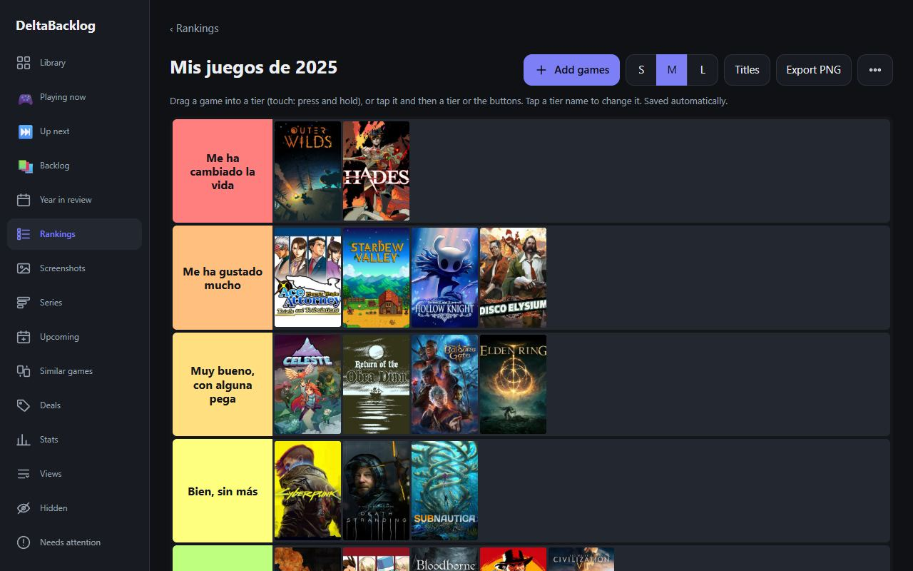

If you delete a game from the library it leaves every ranking.

## 21. Screenshots

Every game can keep its own pictures, for example your best moments or where you stopped.

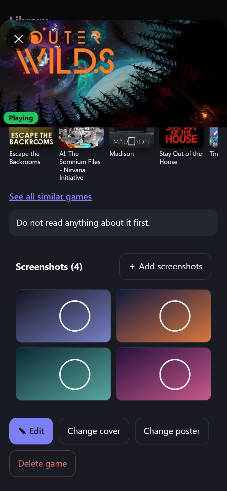

**Add pictures.** Open a game and scroll to **Screenshots**. Tap **＋ Add screenshots** and pick one or several pictures (on a phone, from the photo library or the files; on a computer you can also **drag image files onto the section**). JPEG, PNG and WebP are accepted, up to 25 MB each. You see the progress of every file; if one fails (wrong type, too big, too many pixels) the reason stays next to its name and the others still go in. The original file is kept exactly as it was, with full quality; a small copy is made for the grid.

**Look at them.** Tap a picture to open it full screen. Swipe or use the arrow keys (or the ‹ › buttons) to move between pictures, and pinch to zoom. The date shown is when the picture was taken, when the file knows it.

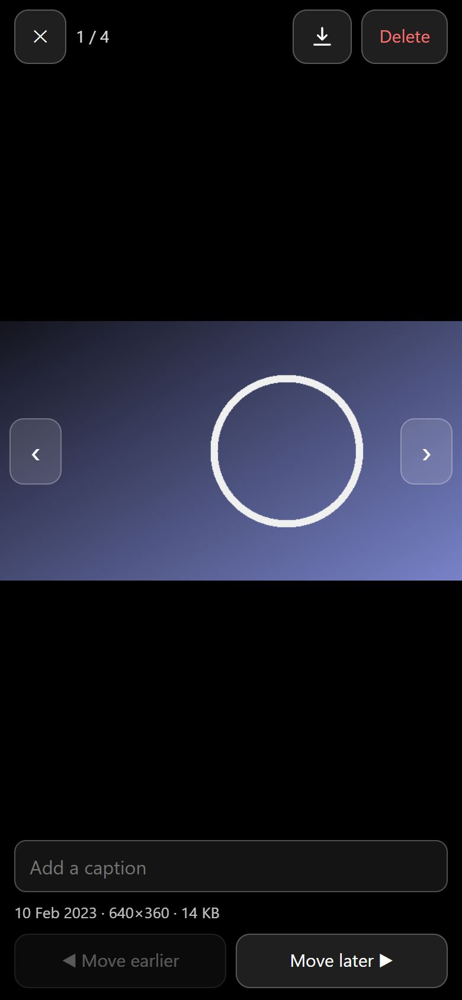

**In the viewer**
- **Caption:** type under the picture; it saves when you leave the box.
- **The download icon** (arrow pointing down) saves the original file.
- **◀ Move earlier / Move later ▶** changes the order of the pictures.
- **Delete** removes the picture. For a few seconds a message offers **Undo**.

**Where the files live.** On the Raspberry Pi, in the screenshots folder (on the external drive when it is set up that way); the app only stores the picture list in its database. If the drive is not connected, you see "Screenshot storage is not available", adding pictures does not work, and the rest of the app keeps working; connect the drive and restart the service. Deleting a game deletes its pictures.

### The Screenshots page

**Screenshots** shows every picture of every game in one place, so you can browse them without opening each game.

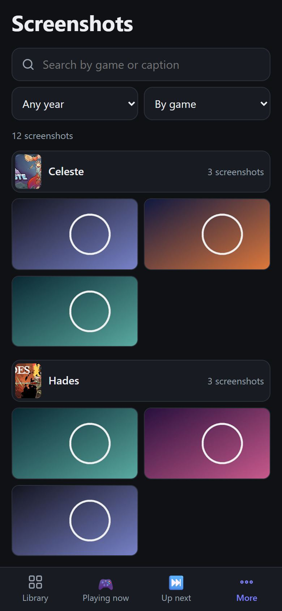

On a PC the grid is wider:

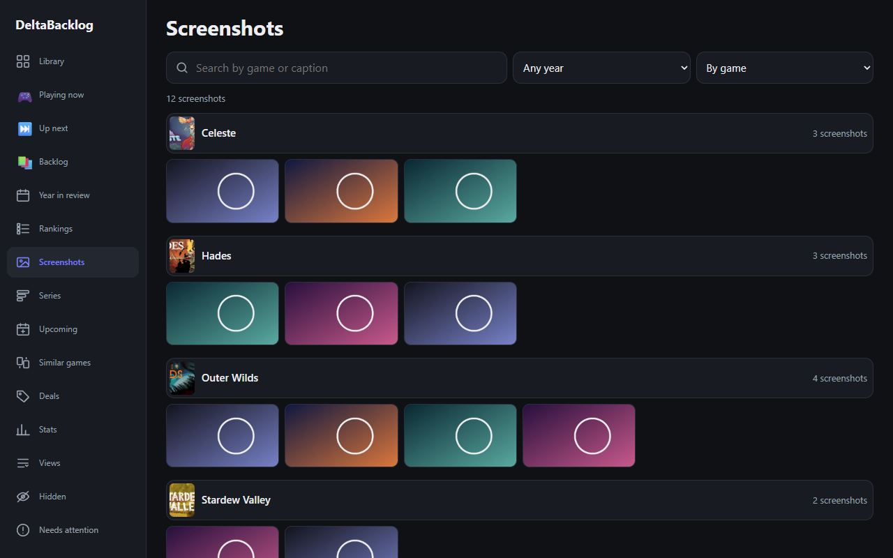

- **By game** (the default) puts the pictures under a header with the game's cover and name; tap the header to open the game. **All, newest first** drops the headers and lists everything by date (when the picture was taken, or when you added it if the file does not know). The choice is remembered on this device.
- **Search** finds a game by name or a picture by its caption. **Year** keeps one year only.
- Long lists load 120 pictures at a time: tap **Show more** at the bottom (the viewer also loads the next ones by itself when you swipe to the end).
- Tap a picture to open the full-screen viewer. Swipe or use the arrow keys to go through **all the pictures that match** (not only that game's). It shows the game's name, the caption, the date and the size, **Original** opens the file in a new tab, the download icon saves it, and **Open game** goes to the game. Captions, order and deleting are done from the game's own page.
- With no pictures yet it says so: add some from a game's details. If the screenshot drive is not connected you get the same "Screenshot storage is not available" notice.

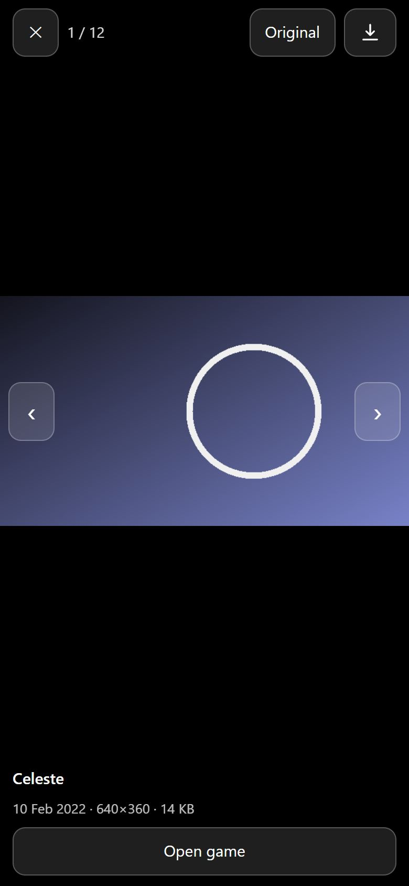

**Copy them off the Pi** (optional), from a computer on your network, replacing the address and folder:

```sh
rsync -a pi@deltabacklog.local:<screenshots-folder>/ ./my-screenshots/
```

## 22. Link your games with IGDB

Games imported from your old table are not yet connected to their page on IGDB, the game database the app uses for covers and details. Linking them is what makes the details, Series, Upcoming and Similar games work for the games you already have. Games you add through the app are linked from the start.

**Step 1: link.** A one-off command on the Pi, `deltabacklog sync-igdb`, connects them (the steps are in the [developer manual](developer-manual.md#8-external-services); `--dry-run` shows what it would do without changing anything). Restart the app afterwards so it shows the new links. It is safe: it first saves a copy of your library, and it only sets the link. It never changes anything you typed, and the app does not show IGDB's scores.

Most games are linked automatically. The ones the app is not sure about wait for you in **Link IGDB** (an entry in the navigation that only appears while there is something to review).

For each game you see its title, year and platforms, and IGDB's best guesses with the platforms IGDB lists for each (handy when two games share a name) and a percentage that says how closely the title matches. A low percentage means the app found no close match and shows IGDB's top results anyway, in case one is right. **IGDB ↗** opens that game's page on igdb.com:
- Tap **Link** next to the right guess.
- **Search IGDB…** lets you look for it yourself; tap the right result.
- **Not on IGDB** if the game is not there at all (a fan game, a regional title). The app will not ask again.
- **Skip** leaves it for later; it comes back the next time you open the screen, or with **Review them again**.

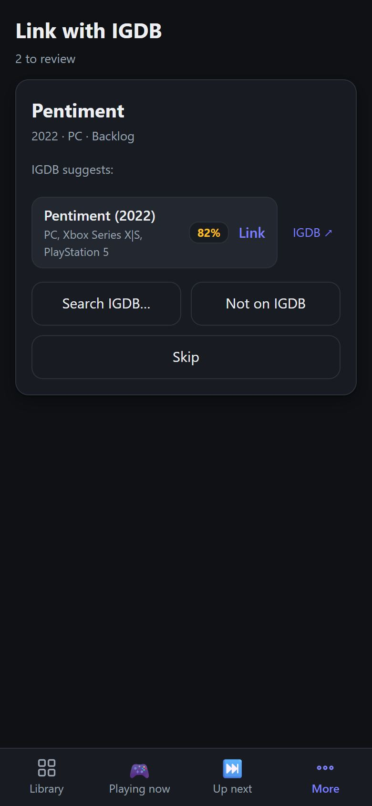

If IGDB's game is already linked to another game in your library you are told which one, and nothing changes. A game that already has a link (for example linked on another device) is never re-linked from this screen.

### Update the details after linking

Whenever a game gets a new IGDB link (**Link** on this screen, or **Fill from IGDB…** in a game's details and then **Save**) a small card asks *Linked to “Name”. Update details from it?* It is also shown by the **Link…** and **Confirm** buttons of the Needs attention page below.
- **Fill empty fields** (the default) only fills what is empty: genres, themes, developer, series, release year and date, game modes, perspectives and the time to beat, and the platform only when it is empty and IGDB lists exactly one that your library already has.
- **Replace all…** first shows a list of what would change (*Genres: Action → Indie, Roguelike*) and replaces only after you tap **Replace**. A series is only replaced by a series your library already has, and platforms are never replaced.
- **Not now** closes the card; the details stay as they are.

Your status, ownership, notes, years played, favourite, covers and any poster you chose are never touched, and a time to beat you typed or took from HowLongToBeat is kept. After an update a message offers **Undo**, which puts back the genres, themes, developer, series, year and platform and says which ones it restored. Game modes, perspectives, the release date and IGDB's times come from the new game and stay. IGDB's times are taken from the new game as a set, so a game never keeps one time from the old IGDB game and another from the new one. It needs the IGDB keys; without them the card says so.

### Needs attention

**Needs attention** (More menu on a phone, sidebar on a PC) lists the games that need a fix, in groups you can open and close, each with how many games it holds. A group starts closed unless it has 3 games or fewer; the app remembers which ones you opened until you close it. Each row has its main button (**Link…**, **Confirm**, **Pick cover**…); the **⋯** button opens a sheet with the other choices (**Not on IGDB**, **Change…**, **Ignore in this list**):
- **Not linked to IGDB**: **Link…** searches IGDB for the game; **Not on IGDB** settles it for good (the app never asks again, and the game leaves the list). Games you already marked that way are not listed.
- **Uncertain IGDB match**: the sync found a likely match but was not sure. **Confirm** keeps the top suggestion (shown with its percentage), **Change…** lets you pick another, and *Review them one by one* opens the Link IGDB screen.
- **No cover** and **No poster, or only a crop of the cover**: open the cover or the poster picker. A poster you chose yourself is never listed.
- **No time to beat** (Backlog, Up Next and Playing) and **Finished, no time to beat**: the games Stats needs a time for (Stats adds up the time of finished games, so a finished game without one makes its figure lower). Dropped and evergreen games are not listed. **Find time** opens the HowLongToBeat search in the game's details. **Find times for all** (one bar, at the top of the first of the two lists, with the count of both) searches HowLongToBeat for every game in both, one after the other (about a second apart; a progress bar shows how far it is, **Stop** ends it). It saves a time only when it is sure: the same title (ignoring capitals and punctuation) and, when both are known, the same release year, with a single such game on HowLongToBeat. The other games stay in the list marked *Needs a manual pick*; use **Find time** on them. It never changes a game that already has a time, and skips the games you ignored here and the ones marked **No time on HowLongToBeat**. When HowLongToBeat does not know a game, use **No time on HowLongToBeat** in the row's **⋯** sheet: the game leaves both lists (it appears under **Show n ignored**, with **Stop ignoring**), Stats counts it as *no time exists*, and an **Undo** message appears. At the end it says, for example, *Found times for 12 games; 5 need a manual pick.* (as a message when the lists are empty by then). The run goes on in the app's server if you leave the page; open the page again to see how it is doing.
- **No platform**, **No release year**, **No ownership** and **No genres**: open the game's edit form at that field.

Tap a game's name to open its details. **Ignore in this list** (in **⋯**) hides the game from that one list only (a *Undo* message appears; **Show n ignored** brings the hidden ones back, each with **Stop ignoring**). Opening the page never contacts IGDB: it works from the games already loaded in the app. The list updates as you fix things.

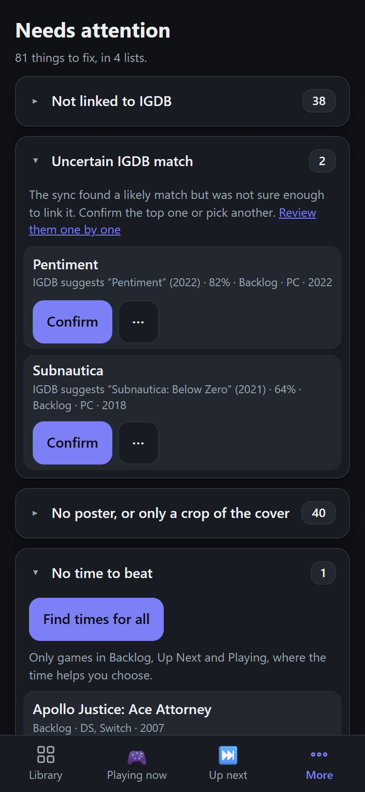

**Step 2: the details.** After the games are linked, a second command reads each linked game from IGDB (`deltabacklog sync-igdb --enrich`). Run its `--dry-run` first: it only prints what it would do. It saves a copy of your library first, too. It **only fills empty fields** (release year, genres, themes, developer, and the platform only when IGDB lists exactly one and your library already has that platform; it never adds a platform). A **series** is only filled when IGDB's collection matches a series you already have, or when two or more of your games share it, because IGDB gives almost every single game a collection named after itself; the command's report lists the ones it left out, so nothing you typed is ever changed. It adds what the app did not have: time to beat, game modes, perspectives and store links, and the dates for Upcoming. Still no scores. If you later link a game to another IGDB game, or unlink it, its IGDB time, modes, perspective and store buttons are removed; run the command again to read the new ones. A series you remove from a game stays removed. Running the command again with `--refresh` only updates the IGDB data (times, modes, perspectives, store buttons) and leaves everything else as it is. At the end it also reads the IGDB collections of your series and the Similar games lists, which feed the Series, Upcoming and Similar games pages. Restart the app afterwards to see the new data.

## 23. Refresh buttons

The pages that use other websites keep what they read on the server. **Opening a page, a game or the app never asks IGDB or IsThereAnyDeal**: you decide when, with a refresh button. Each refresh runs in the background with a progress count, one at a time, and keeps going if you leave the page; what it already stored stays if it is stopped.

| Page and button | What it reads | When to press it |
|---|---|---|
| **Series** → **↻ Refresh** | IGDB: the collections behind your series, the games you do not have, their small posters and the dates of new games | after linking games, or when you want to see new games of a series |
| **Upcoming** → **↻ Refresh from IGDB** | the same run as Series, which also reads the release dates of the new games | now and then, to catch announced dates |
| **Similar games** → **↻ Refresh from IGDB** | IGDB's similar-games lists for the games you finished or favourited | after finishing games you liked |
| **Needs attention** → **Find times for all** | HowLongToBeat (no key): a time to beat for the games of the *No time to beat* group, one search at a time, saved only when the match is certain | when many games lack a time; the ones it cannot be sure of stay for you ([section 22](#needs-attention)) |
| **Deals** → **↻ Refresh prices** | IsThereAnyDeal: the price now and the historical low of the games you don't own and haven't played yet, except the ones you hid (about one request per 50 games) | before you buy something |
| **The price check every 6 hours** (no button) | the same prices as **↻ Refresh prices**, read by a timer on the Raspberry Pi about every 6 hours (02:00, 08:00, 14:00, 20:00), which also sends the price alerts (and the Telegram messages) | nothing to press: open **Deals** to see the result ([section 17](#17-deals)). On a PC run `deltabacklog deals-check` |

Things that never happen on their own: reading a website when a page opens (the one scheduled read is the Pi's price check every 6 hours in the table above), adding a game to your library, changing a status, changing a cover or a poster you chose or uploaded, replacing times you set or took from HowLongToBeat. Adding or linking a game to IGDB does read that one game at once (its details and release date), and linking a game to a different IGDB game also fetches that game's poster, unless the poster is your own. Searching HowLongToBeat for one game (**Get from HowLongToBeat**, **Find time**) happens only when you press it.

If a refresh is refused or stopped (too many requests, a wrong key, no connection) the page says why and keeps what it had; try again later.

## 24. If something looks wrong

- **The page looks old after an update.** Browsers can keep a copy of the app (a "service worker", used when the app is reached over HTTPS or on the same computer). Reload twice (on a PC: Ctrl+Shift+R). If it still looks old, clear the site's data in your browser settings once.
- **A page says it is "not set up".** The key for that page is missing: IGDB or SteamGridDB for lookups and `ITAD_API_KEY` for Deals. See [section 3](#3-setting-up-keys). Games can still be added by hand.
- **A page saying "unknown host".** The app only answers to its own address, `deltabacklog.local`, the Pi's hostname and IP addresses. If you open it by another name (a router name, a Tailscale name, a reverse proxy), add that name to `ALLOWED_HOSTS` in `/etc/deltabacklog.env` on the Pi (for example `ALLOWED_HOSTS=raspberry.lan`) and restart the app with `sudo systemctl restart deltabacklog`.
- **A cover is missing.** Open the game, tap **Change cover** and pick one. Adding a game never fails because of a cover: if the picture could not be downloaded you are told, and the game is added anyway.
- **A poster is wrong** (Series, Upcoming, Similar games, Deals, rankings). Open the game and tap **Change poster**, pick the right one ([section 12](#the-poster-portrait-picture)). Your pick is kept.
- **I pressed Send test message and nothing arrived.** Deals only shows the button (in the **i** panel) when `TELEGRAM_BOT_TOKEN` and `TELEGRAM_CHAT_ID` are set. If it says Telegram refused, check the token (from @BotFather) and that you sent your bot a message first, or added it to the group; the chat id is a number (`-100…` for a group). Edit the settings file, restart the app and try again. The alerts are still in the app, and an alert that could not be sent is tried again at the next check.
- **The Wishlist says "the rest next run".** IsThereAnyDeal limits how many requests a key may make in a few minutes. Deals looks up your whole wishlist in one or two requests and prices what it found before it stops, so this is rare; if it happens, press **↻ Refresh prices** again after a few minutes and the rest follows. A game that Steam cannot name (one that was removed from the store, for example) is listed as *Steam app 123*.
- **A price is for the wrong game.** Open the game on the Deals page (or its details) and tap **Wrong game?** or **Pick the game** ([section 17](#17-deals)).
- **The Wishlist button is missing, or it is empty.** The button only appears when `STEAM_ID` is set (17 digits; a wrong one is ignored and the app log says so, without showing it), and the list fills when you press **↻ Refresh prices**. If it says the wishlist is empty or not public, see *Making your wishlist public* in [section 17](#17-deals).
- **An uploaded cover or poster is refused.** The picture must be a JPEG, PNG or WebP of at most 10 MB and 40 megapixels. A phone photo is shrunk first, so *too large* usually means a huge or unusual file (a very big progressive JPEG or a 16-bit PNG): open it in a photo app, export it as a normal JPEG and try again. The message also says when the file is the wrong type or damaged.
- **A series shows no games I do not have.** Those games need the series' games to be linked to IGDB ([section 22](#22-link-your-games-with-igdb)) and a press of **↻ Refresh** on the Series page.
- **A change did not save.** You see a message at the bottom. The game goes back to how it was, so try again.
- **I added the same game twice.** The add form warns you when a game with the same title or IGDB link is already there. Open the extra copy and use **Delete game**.

## 25. Backups and what is still missing

**Backups happen by themselves.** Every night at 03:30 the Raspberry Pi saves a copy of your library and keeps the last 14 days. Restoring one is described in the [developer manual](developer-manual.md#11-build-and-deploy).

**Screenshots are backed up too.** Each night the new pictures are copied to a second place, so the originals and the copy are on different disks (if the pictures live on the external drive, the copy goes to the SD card, as long as the SD card keeps 5 GB free). Pictures you delete in the app stay in that copy until you clear it by hand. When the pictures are on the external drive, each night's library copy is also saved on that drive. Details and restore steps are in the developer manual.

**Not built yet:** a full export of everything (the **Export CSV** button of the table, [section 9](#9-the-table-spreadsheet-layout), already saves the games you see).
